# Building and scripting

This section shows how to make and change objects, work with scripts and notecards, and upload your own images and models.

You build in a region that lets you. On land you do not own, you can often still look, but not change things.

## Keys at a glance

| Keys | What |
|---|---|
| Ctrl+B | Build mode on or off |
| Ctrl+1, Ctrl+2, Ctrl+3, Ctrl+4 | Focus, Grab, Edit, Create |
| Ctrl+D | Duplicate the selection |
| Ctrl+L, Ctrl+Shift+L | Link, Unlink |
| Ctrl+. and Ctrl+, | Select the next part, the previous part |
| Ctrl+Z, Ctrl+Y | Undo, Redo |
| G | Snap to Grid on or off |
| Shift+X | Snap Object XY to Grid |
| Shift+G | Use Selection for Grid |
| Ctrl+Shift+B | Grid Options |
| Ctrl+U | Upload an image |
| Ctrl+Alt+U | Upload a model |
| Esc | Leave build mode |
| F2, Delete (in the Content list) | Rename, delete the chosen item |
| Ctrl+S, Ctrl+F (in a script or notecard window) | Save, find |

In a text field, Ctrl+Z and Ctrl+Y undo and redo the typing, not the object.

## Build mode and the four tools

Choose **Build > Build** (Ctrl+B). The **Build** window opens. Press Esc or close the window to leave build mode. Leaving clears the selection.

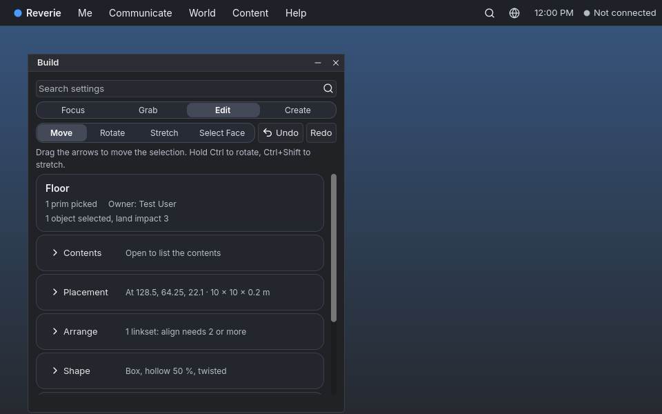

The top row of the window has the tools. You can also choose them from the **Build** menu, or by key.

| Tool | Key | What it does |
|---|---|---|
| **Focus** | Ctrl+1 | Click to look at a point. Hold Ctrl and drag to orbit. Hold Ctrl+Shift and drag to pan. |
| **Grab** | Ctrl+2 | Drag an object to move it. Hold Ctrl to lift it, Ctrl+Shift to spin it. Called the Move tool in the official viewer. |
| **Edit** | Ctrl+3 | Click an object to select it, then change it with the handles or the window. |
| **Create** | Ctrl+4 | Choose a shape, then click the ground or an object to place it. Esc cancels. |

A fifth button, **Land**, is greyed. The land tools are not in Reverie yet.

A line under the tools tells you what the mouse does with the tool you have. It changes while you hold Ctrl or Ctrl+Shift.

### The shapes and the Create options

With **Create** the window shows fifteen shape buttons: **Cube**, **Prism**, **Pyramid**, **Tetrahedron**, **Cylinder**, **Hemicylinder**, **Cone**, **Hemicone**, **Sphere**, **Hemisphere**, **Torus**, **Tube**, **Ring**, **Tree** and **Grass**. Press one, then click the ground or an object. A shape you make arrives selected. A tree or a patch of grass does not: the region picks a kind of tree or grass at random, and a patch of grass comes in a random size.

- **Keep Tool selected**: stay in Create after each placement. Otherwise the tool goes back to Edit. The size of a new shape is set in Preferences > Building.
- **Copy selection**: the next click places a copy of what you have selected instead of a new shape. Pressing a shape button turns it off again. Nothing is copied if you have nothing selected.
- **Center Copy** and **Rotate Copy**: only while Copy selection is ticked. Center Copy is on by default. They decide how the copy sits at the click.

### Duplicate

Choose **Build > Object > Duplicate** (Ctrl+D). Each selected object is copied half a metre east and north of itself, and the copies become the selection. It is greyed unless something you may copy is selected. A worn object is never duplicated.

With the Grab or Edit tool and the move handles, hold **Shift** and drag an arrow. When the pointer has moved two pixels, a copy stays where the object was and the original goes on with the drag. A click without a drag leaves no copy.

### Select objects

1. Choose the **Edit** tool.
2. Click an object. Its name and owner show in the card at the top of the window.
3. Shift+click another object to add it, or take it out again.
4. Or drag a box around several objects.

**Select Only My Objects** (Build > Options, or the tick in the Object section) skips objects that are not yours.

## The Build window

Under the tools, the Edit tool has four modes: **Move**, **Rotate**, **Stretch** and **Select Face**. **Undo** and **Redo** sit beside them.

Below that, the window has folding sections: **Contents**, **Placement**, **Shape**, **Look**, **Object** and **Behaviour**. Click a heading to open or close it. Reverie remembers which ones you opened. A closed section shows a one-line summary. The **Search settings** line at the top finds a setting by name. It also knows the names other viewers use.

### Handles

With the Edit tool, a selected object shows handles.

1. **Move**: drag a coloured arrow to move the object along that axis.
2. **Rotate**: hold Ctrl, then drag a ring to turn the object. Hold the pointer near the ring for a smooth turn. Hold it well away from the middle and the turn snaps in steps.
3. **Stretch**: hold Ctrl+Shift, then drag a box to resize the object. **Stretch Both Sides** and **Stretch Textures** are in the Placement section.
4. **Select Face**: click one face to pick it so you can texture it alone. Shift+click adds or removes faces.

The object follows the pointer while you hold the button, and stays where you let go.

### The selection card

The card at the top shows how many objects are selected and their **land impact**, for example "1 object selected, land impact 3". It is the region's figure for the whole linked object, added up for each selected object that is not worn. It reads 0 until the region answers, and shows nothing for a region that does not report it.

### Placement

Type exact numbers for **Position**, **Size** and **Rotation**, then press Enter. There are **Copy** and **Paste** buttons for position, size, rotation, all three, or the object's shape settings. **Snap to grid** is a tick here too.

### Shape

Choose a **Building block type**: Box, Cylinder, Prism, Sphere, Torus, Tube or Ring. The settings below it change with the type. They include Path cut, Hollow, Twist, Taper and Top shear. Sculpted shows as a type, but you cannot choose it here.

### Look

This is where you change the object's surface. It is the Texture tab of other viewers. If you picked faces, the change goes to those faces. Otherwise it goes to the whole object.

- **Texture**: press **Choose from inventory**, or **Local file...** to try a file from your own computer. A local texture shows only on your computer until you upload it.
- **Color**: click the swatch to open the colour picker. See below.
- **Transparency %**, **Glow** and **Full Bright**.
- **Mapping**, **Horizontal scale** and **Vertical scale**, **Rotation degrees**, **Horizontal offset** and **Vertical offset**, and **Align** for planar faces.
- **Material**: press **Choose material from inventory** to give the face a PBR material. **Remove** takes it off again. Scale, offset and rotation of the material have their own boxes. If your inventory has no material, the window says "No materials in your inventory".

### The colour picker

Every colour box in Reverie opens the same **Color Picker**.

1. Click a colour box. The picker opens.
2. Choose a colour by one of these:
   - drag in the square and on the **Hue** bar;
   - type **R**, **G**, **B**, **H**, **S**, **L** or **Hex** values;
   - click a swatch under **Standard colours**, **My colours** or **Recent**;
   - press **Pick**, then click any colour on the screen. Esc stops.
3. Set **Transparency %** where it applies.
4. Press **OK**.

**New** shows your choice and **Was** shows the old colour. Press **+** to keep a colour in **My colours**. Tick **Apply as I choose** to see each change on the object at once. **Cancel** puts the old colour back.

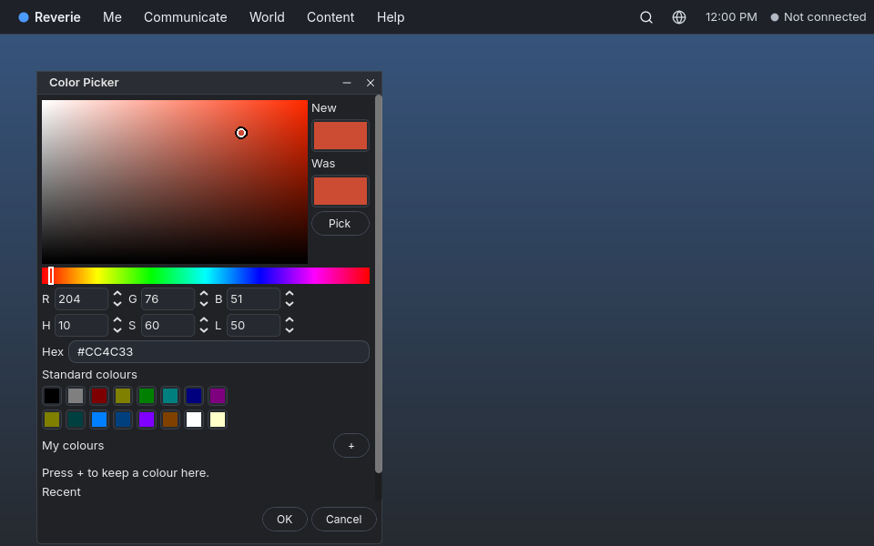

### Object

- **Name** and **Description**.
- **Creator** and **Owner**.
- Permissions: **Share with group**, **Anyone can move**, **Anyone can copy**, and what the **Next owner can** do (Modify, Copy, Transfer).
- **For sale**: tick it, choose the sale type (**Copy**, **Contents** or **Original**) and set the price in L$. A price of 0 is allowed. The controls are greyed for an object that is not yours or that you cannot transfer, and show nothing definite when the selected objects differ. When every selected object was still on Touch or Buy, putting it up for sale also sets **Buy**, and taking it off sale sets **Touch**.
- **When left-clicked**: what a left click on the object does: **Touch (default)**, **Sit on object**, **Buy object**, **Pay object**, **Open**, **Zoom** or **Ignore object**, or **None** (the click does nothing). It goes to every part of the selected object. **Buy object** is refused for an object that is not for sale. **Pay object** is set with a warning when no script takes money. **Zoom** moves the camera to frame the object. **Ignore object** lets clicks pass through the object while the Build window is closed. The play and open-media actions that media controls set are not run, because Reverie shows no media on a prim yet.
- **Locked**, **Physical**, **Temporary** and **Phantom**.
- **Edit linked**, **Select Only My Objects**, and the **Link** and **Unlink** buttons.

### Behaviour

- **Flexible Path**, with its Softness, Gravity, Drag, Wind, Tension and Force settings.
- **Light**, with colour, intensity, radius and falloff, and a projector image with FOV, focus and ambiance.
- **Physics Shape Type**: Prim, None or Convex Hull, and the material (Stone, Metal, Glass, Wood, Flesh, Plastic or Rubber) with its gravity, friction, density and restitution.

## Link objects and work with the parts

**Link**

1. Select two or more objects that are all yours. Click the first, Shift+click the others.
2. Choose **Build > Link** (Ctrl+L), or press **Link** in the Object section.

If **Edit linked** is on, turn it off first. Reverie tells you if you may not change every object, if an object is not yours, or if there are too many parts.

**Unlink**: select the linked object and choose **Build > Unlink** (Ctrl+Shift+L).

**Work on one part**

1. Tick **Edit linked** (or choose **Build > Edit Linked Parts**).
2. Click a part of the linked object. Only that part is selected.
3. Press Ctrl+. for the next part and Ctrl+, for the previous one.

## Undo

**Build > Undo** (Ctrl+Z) and **Redo** (Ctrl+Y) work on what is selected. The Undo and Redo buttons in the Build window do the same.

Undo covers moves, turns and resizes. It does not cover shape, texture, name, linking or deleting. On an OpenSimulator grid, the region remembers only the last few steps for a few minutes. A new change clears Redo.

## Grid snapping

Snapping makes moves and turns land on even steps.

- **Build > Options > Snap to Grid** (G) turns snapping on or off. The tick **Snap to grid** in the Placement section does the same.
- **Snap Object XY to Grid** (Shift+X) moves the selected object's position to the nearest grid point now.
- **Use Selection for Grid** (Shift+G) makes the grid follow the object you selected.
- **Grid Options...** (Ctrl+Shift+B) opens a small window: **Ruler mode** (World, Local or Reference), **Units (meters)**, **Extents (meters)**, **Sub-units** and **Opacity**.

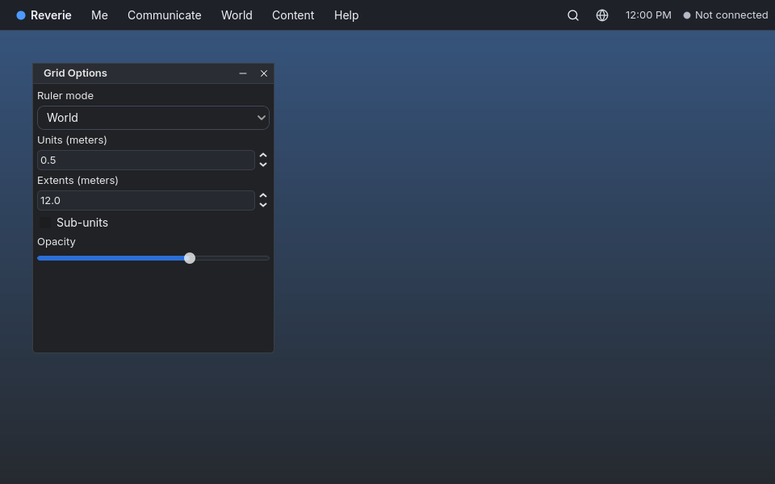

Snap Object XY to Grid and Use Selection for Grid are greyed until something is selected in build mode.

## Take, take copy and delete

Right-click an object in the world. The menu has:

- **Take**: puts the object into your inventory (in the Objects folder) and removes it from the world.
- **Take Copy**: puts a copy into your inventory and leaves the object where it is. It shows only for an object you may copy.
- **Return**: sends the object back to its owner. A question asks first; choose its **OK** entry to go on. It is greyed for something you wear. Whether you may return the object is decided by the region: your own objects, and objects on land you own or have the rights to manage.
- **Delete**: moves the object to your Trash. For an object that is locked, cannot be copied, or is not yours, a question asks first. Choose its **OK** entry to go on. Closing the menu cancels.

When an object is for sale and is not yours, **Buy** takes the place of **Take**. For your own worn objects, see [Inventory, outfits and appearance](inventory-and-appearance.md).

To take into a folder you choose:

1. Select the object in build mode.
2. Choose **Build > Take Into Folder...**.
3. Pick a folder. A search line helps to find it.
4. Press **Take**.

## The Content section

Every object can hold things: scripts, notecards, textures and other items. The **Contents** section of the Build window lists them for the selected object.

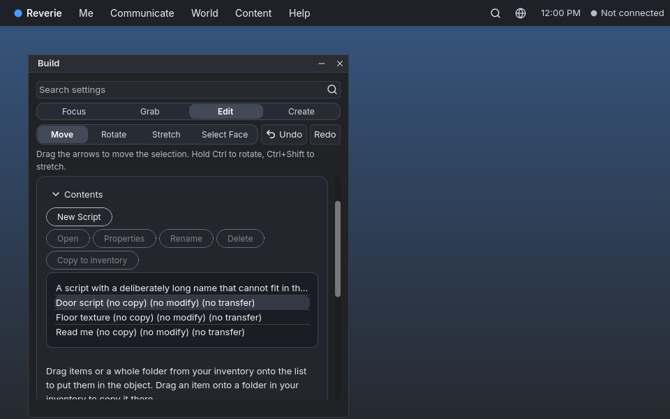

- **New Script** puts a new script into the object.
- Select a row to use the buttons: **Open**, **Properties**, **Rename**, **Delete** and **Copy to inventory**. Right-click a row for the same choices.
- Ctrl+click and Shift+click choose several rows.
- A row says "(no copy)", "(no modify)" or "(no transfer)" when you may not do that.
- **Open** works for scripts, notecards, gestures and textures. Double-click does the same.
- **Properties** shows the name, description, creator, owner and permissions. Change the name and description if you may modify the item, then press **Save**.
- **Rename** opens the same box with the name selected.
- **Delete** removes the item from the object. The item goes to your Trash.

Keys, with the list in focus (click a row first):

- **F2** renames the chosen item. It opens the Properties box with the name selected. Type, then press Enter.
- **Delete** removes every chosen item.

To put things in:

- Drag items from the Inventory window onto the list.
- Drag a whole folder onto the list. Its items go in one at a time.
- Drag a row out onto an inventory folder to copy it there.

To change a script of an object you do not own, you need the right to modify it. Without it, Reverie tells you.

## The script editor

Open a script by double-clicking it in the Inventory or in the Contents list, or by choosing **Open** on it.

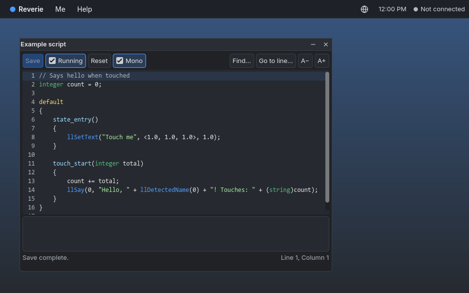

The bar at the top has:

- **Save**, which also compiles the script on the grid.
- **Running** and **Reset**. These show only for a script inside an object. **Running** is a tick: clear it to stop the script. **Reset** starts it again from the top.
- **Find...** and **Go to line...**. Ctrl+F also opens find. Find has **Replace with**, **Match case**, **Find next**, **Replace** and **Replace all**.
- **A−** and **A+** change the text size.

Press **Save** (or Ctrl+S) to save and compile. Errors and warnings show in the **Errors and warnings** list below the text. The line and column show under the text. The status line says "Save complete." when the grid has taken it.

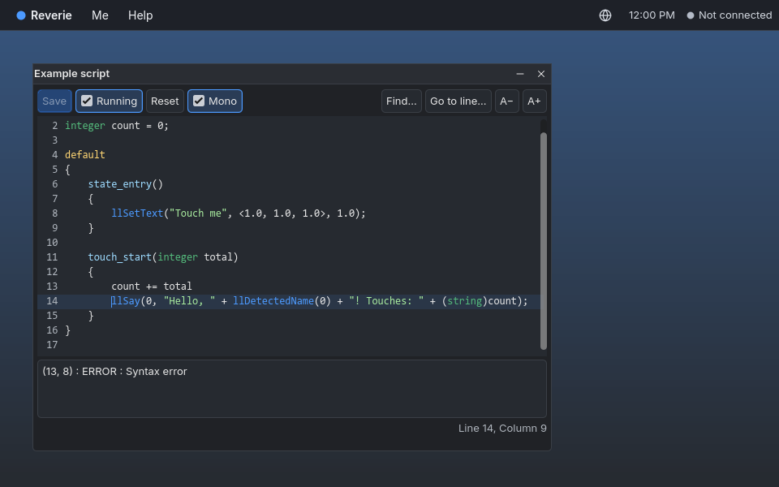

If you close the window with unsaved changes, a question asks **Save**, **Don't Save** or **Cancel**. If you may view the script but not change it, the editor is read-only and says so.

### Choosing the script engine

Which engine runs a script depends on the grid. The engine row sits in the bar at the top of the script editor, after **Reset**.

On OpenSimulator and its relatives the row shows where the region lists one or more engines, or runs Lua. Until you ask for a choice, it only tells you what runs the script. The drop-down is greyed and names the engine and why: a choice you saved, the engine the script's first line asks for (for example `//YEngine:`), or the region's default.

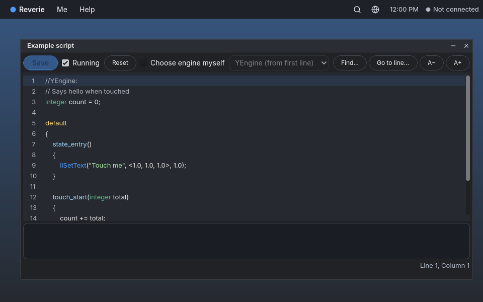

To choose the engine yourself:

1. Open the script and look at the bar. If **Choose engine myself** is not there, the region offers no choice and nothing more is needed.
2. Tick **Choose engine myself**. The drop-down turns on.
3. Open the drop-down and pick an engine, for example **Phlox (LSL)**.
4. Press **Save** (or Ctrl+S). The script is saved and compiled for that engine.
5. To go back, clear the tick. The region then uses the script's first line, or its own default again. You can also right-click a script in the Contents list and use **Engine**, where **Use the first line or region default** clears your choice.

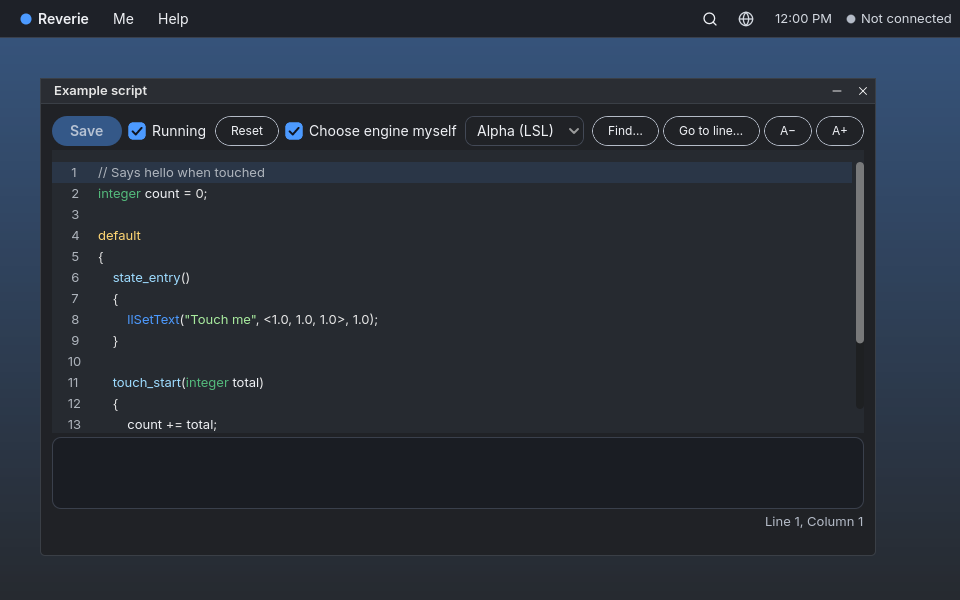

Where the region runs Lua, the list also has **SLua (LSL)** and **SLua (Lua)**. Pick **SLua (Lua)** for a script written in Lua; the editor then colours it as Lua. **SLua (LSL)** runs an LSL script on the Lua engine.

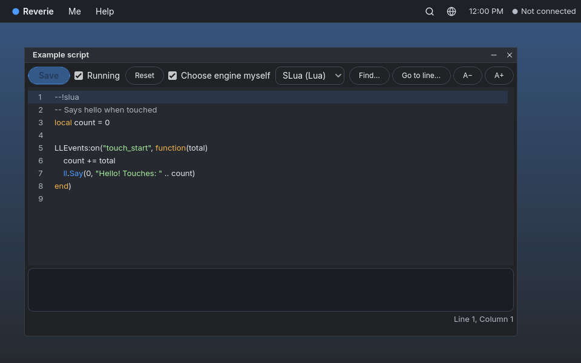

An engine the region marks as early access says so in its name. The first time you pick one, a line under the code warns that it may not keep a script's state across future updates.

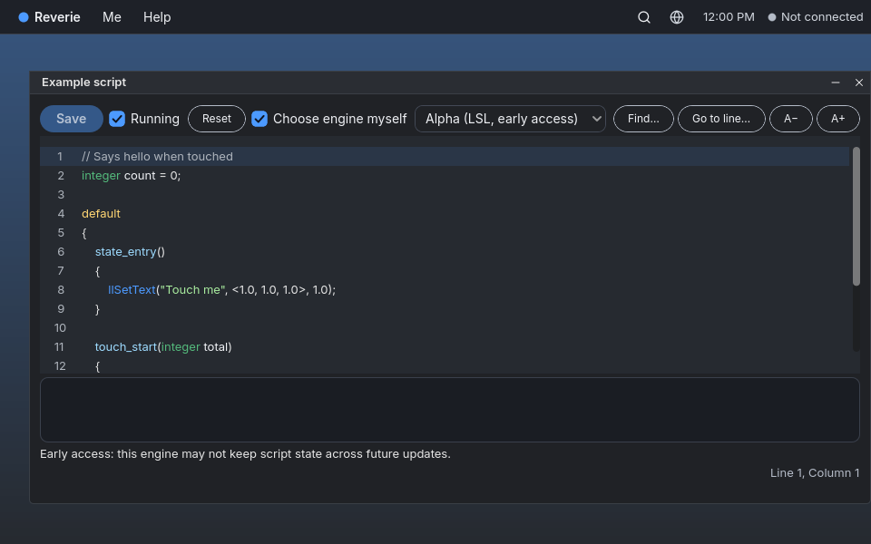

A region can list engines and still not keep a choice you make. Then the tick is greyed, and its tooltip says that the region does not keep engine choices. A first line such as `//YEngine:` picks the engine instead. Where the region also runs Lua, the tick stays on, the engines that cannot be kept are greyed in the list with a tooltip, and the SLua choices work.

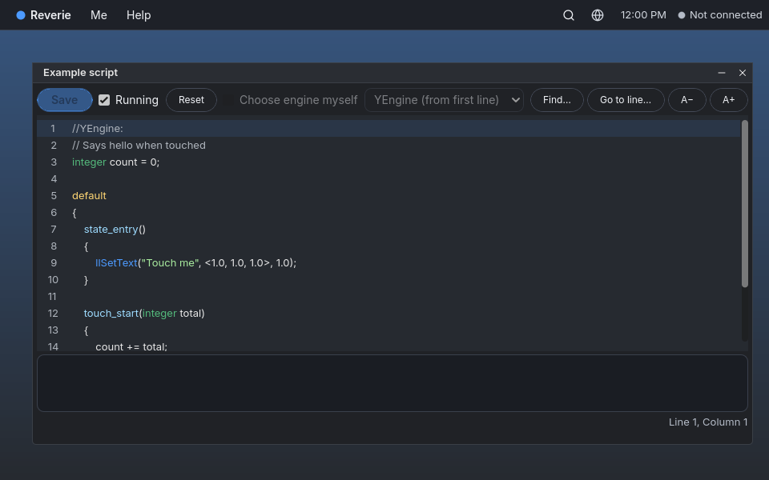

On Second Life the row is a **Compile as** list with four choices: **LSL Legacy**, **LSL on Mono (recommended)**, **LSL on Lua** and **Lua**. The two Lua choices are greyed in a region that does not run Lua. There is no tick.

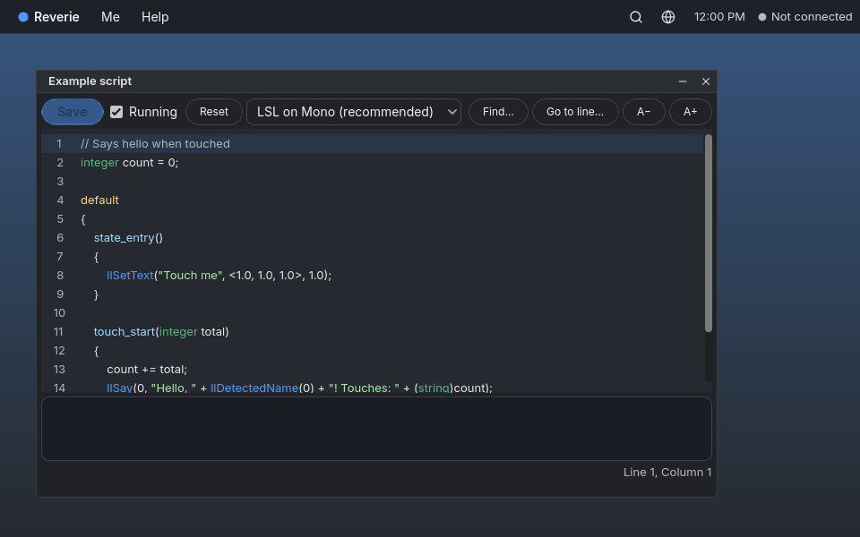

On a grid that offers no choice, the engine list does not show.

## Notecards

Double-click a notecard in the Inventory or in the Contents list.

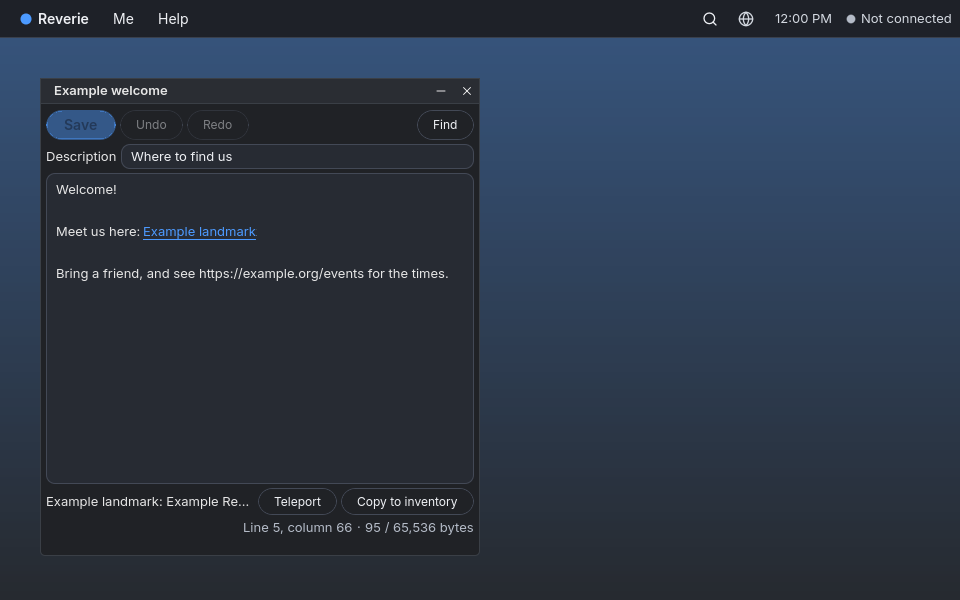

- Write in the text area. **Save** (or Ctrl+S) stores it. The size shows as "n / m bytes".
- **Undo**, **Redo** and **Find** (Ctrl+F) are in the bar.
- Drag an item from your inventory into the text to put it in the notecard. Only an item whose next owner may copy, modify and transfer it can go in.
- A notecard you may not change is shown read-only.
- **Copy to inventory** asks "Copy this item to your inventory?" before it copies.
- A place in a notecard shows with a **Teleport** button in its row. A place window is not built yet.

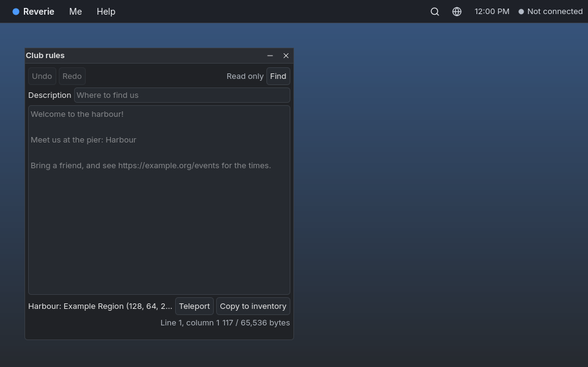

## Gestures

A gesture plays animations, sounds and chat lines in order. See [Chat and people](chat-and-people.md) for the Gestures window, which lists your gestures and has the **Edit** button.

You open the gesture editor in three ways:

- In the Inventory, double-click the gesture (or select it and press Enter, or choose **Open**).
- In the Gestures window, select a gesture and press **Edit**.
- Make a new gesture from **Create new** in the Inventory. It opens at once.

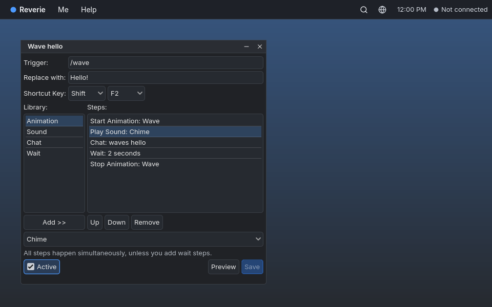

1. Type a **Description**.
2. Set a **Trigger:**, a word that plays the gesture when you say it. **Replace with:** changes the word to other text.
3. Choose a **Shortcut Key:** from a modifier (**None**, **Shift** or **Ctrl**) and a key.
4. In **Library:** choose **Animation**, **Sound**, **Chat** or **Wait**, set it up, then press **Add >>**.
5. Use **Up**, **Down** and **Remove** on the **Steps:** list.
6. Tick **Active** so the gesture is on.
7. Press **Preview** to try it. Press **Save**.

The help line says: "All steps happen simultaneously, unless you add wait steps."

For an **Animation** step, choose **Start** or **Stop** and then the animation. The list starts with the 69 built-in animations of Second Life, followed by the animations in your inventory, by name. A **Sound** step takes a sound from your inventory. A **Chat** step takes text. A **Wait** step waits **until animations are done**, or for a time in seconds.

## Build > Scripts

Choose **Build > Scripts** to work on every script in the selected objects at once. It is greyed until something you may edit is selected.

- **Recompile Scripts (Mono)**
- **Recompile Scripts (LSL)**
- **Reset Scripts**
- **Set Scripts to Running**
- **Set Scripts to Not Running**

A progress window opens, named after the action (for example "Recompilation Progress"). It lists each script as it is done. **Close** works when the line "Done." appears.

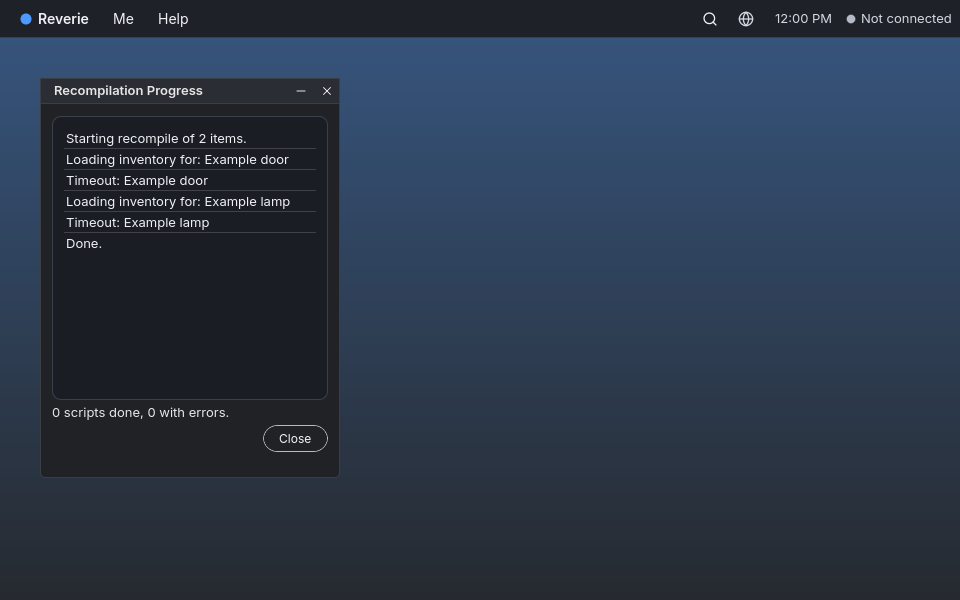

## Upload images and models

Uploads go through **Build > Upload**. A grid may charge a fee. The window shows the cost before you confirm, and shows when the grid refuses.

### Upload an image

1. Choose **Build > Upload > Image...** (Ctrl+U).
2. Choose a file. PNG, JPG, TGA and BMP files work.
3. In the **Upload Image** window, set the **Name** and **Description**. It shows the size the image will arrive at, and the cost.
4. On a grid that allows it, tick **Allow 2048** to keep a larger image.
5. Press **Upload**. Its button shows the price when there is one.

The image goes into your Textures folder. A notice with **Show in inventory** appears when it is done. Files larger than 8096 pixels on a side are refused.

**Bulk...** takes many images at once. The **Bulk Upload** window lists each file with its name, its size or why it cannot go, and its progress. It shows "n of m uploaded" at the end.

### Upload a model

1. Choose **Build > Upload > Model...** (Ctrl+Alt+U).
2. Choose a `.glb`, `.gltf` or `.dae` file.
3. In the **Upload Model** window, check the **Triangles**, the levels of detail and the **Land impact**.
4. Tick **Generate levels of detail** if the file has only one. Choose **Physics** (**None (a convex hull)** or **Lowest level of detail**). Tick **Include textures** to upload the textures with it, and set the **Scale**.
5. Read the fee line. Press **Upload**.

The model goes into your Objects folder. **Bulk models...** loads several at once.

Reverie does not upload rigged (skinned) models yet. A model with more than 8 materials, or a material with more than 65,535 vertices, is refused.

## Not in Reverie yet

- The Land tool (shaping and selecting land).
- Rigged mesh upload.
- Undo for changes other than moves, turns and resizes.

See also [Keyboard shortcuts](keyboard-shortcuts.md) and [Fixing problems](fixing-problems.md).
