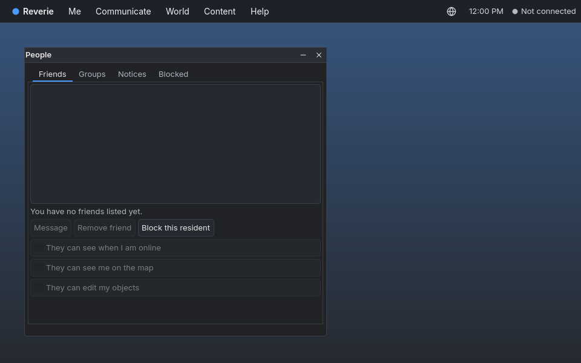
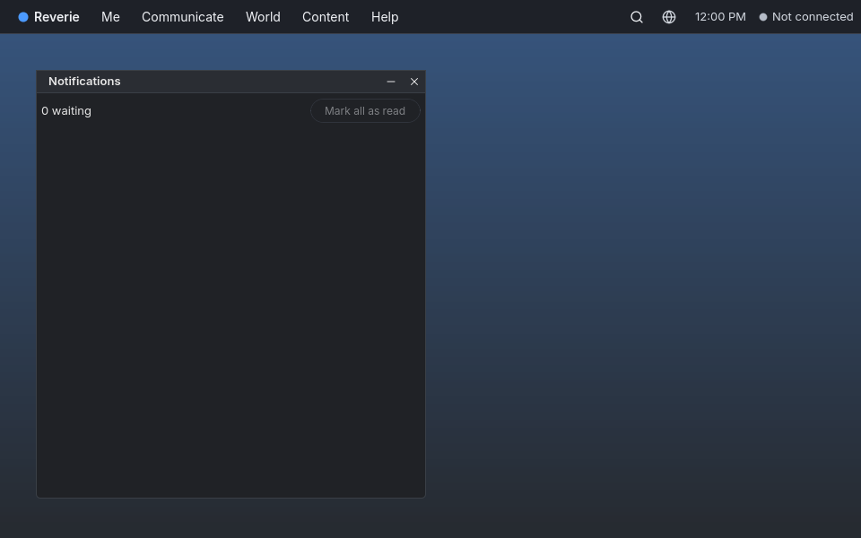
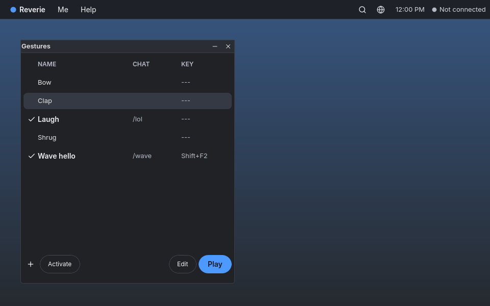

# Chat and people

This section shows how to talk to people: in nearby chat, in private messages and in group chat. It also covers friends, groups, teleport offers, notifications and gestures.

All of this needs a login. The Reverie windows named here open from the **Communicate** menu, from the dock, or by their key. See [Finding your way around](finding-your-way-around.md).

## Keys at a glance

| Keys | What |
|---|---|
| Ctrl+H | Nearby chat window |
| Ctrl+T | Conversations window |
| Ctrl+Shift+A | People window |
| Alt+Shift+N | Notifications window |
| Ctrl+G | Gestures window |
| Enter (in a chat line) | Say it |
| Shift+Enter (in the nearby chat line) | Whisper it |
| Ctrl+Enter (in the nearby chat line) | Shout it |
| F2 to F12 | Play the gesture bound to the key |

## Nearby chat

Nearby chat is what people around you can hear. It shows in the **Nearby chat** window, and in the chat bar.

### The chat bar

When you are in the world, a chat bar sits above the dock. It has a line to type in, a **Say** / **Whisper** / **Shout** choice, and a **Send** button. It speaks into the same nearby chat as the window.

### Say something

1. Click the chat bar.
2. Type your message.
3. Press **Enter**. Or press **Send**.

To open the window with the history, choose **Communicate > Nearby chat** (Ctrl+H), or press the **Chat** button on the dock.

### Whisper and shout

How far your words carry depends on how you send them.

- **Say** reaches the normal distance.
- **Whisper** reaches a short distance.
- **Shout** reaches a long distance.

To choose:

- Press **Shift+Enter** to whisper this one line.
- Press **Ctrl+Enter** to shout this one line.
- Or pick **Whisper**, **Say** or **Shout** in the box next to the line. It stays until you change it.
- Or start the line with `/whisper` or `/shout`.

### Channels

Chat on channel 0 is for people. Scripts also listen on other channels.

- To speak on a channel, start the line with a slash and the number: `/5 hello` speaks on channel 5. A negative number works too, for example `/-1 hello`.
- To speak on the same channel again, start with two slashes: `//hello`. It uses the last channel you named.

### Emotes

A line that starts with `/me` is an emote. `/me waves` shows your name followed by "waves".

### Names and links

Click a person's name in the history. It opens a private conversation with them. Click an object's name to see its owner and where it is.

### What else you see

- When someone is typing, a line under the history says so.
- Chat lines also show over the world for a while. Preferences > Chat sets how long, the text size, and whether lines show the time.

## Conversations

Private messages and group chat live in the **Conversations** window. Open it with **Communicate > Conversations** (Ctrl+T), or the **Convos** button on the dock.

There is one tab for each conversation. A tab shows how many messages you have not read yet. Click a tab to read it.

### Send a private message

1. Open a conversation. You can do it three ways:
   - Click the person's name in nearby chat.
   - Right-click their avatar and choose **IM**.
   - In **People > Friends**, pick a friend and press **Message**.
2. Type in the line at the bottom.
3. Press **Enter**. Or press **Send**.

The other person sees when you are typing. The conversation also shows when they are.

To end a conversation, press the **Close conversation** button (the X) at the bottom.

### Group chat

1. Open **Communicate > People**, and choose the **Groups** tab.
2. Pick a group.
3. Press **Open group chat**. A double-click on the group does the same.

The group chat opens as a tab in Conversations.

### Conferences

A conference is one chat with several friends.

1. Open **Communicate > People**. Stay on the **Friends** tab.
2. Pick two or more friends. Click each one.
3. The **Message** button now says **Start conference**. Press it.

### Offer friendship from a conversation

A private conversation has an **Offer friendship** button. Press it to ask the other person to be your friend.

## The People window

Open it with **Communicate > People** (Ctrl+Shift+A), or the **People** button on the dock.

It has four tabs: **Friends**, **Groups**, **Notices** and **Blocked**.

### Friends

The list shows your friends. A friend who is online is marked "(online)".

Pick a friend to see the buttons:

- **Message** opens a private conversation. With several friends picked, it becomes **Start conference**.
- **Remove friend** ends the friendship. The viewer asks you to confirm first.
- **Block this resident** blocks them. See Blocked below.

Under the buttons are three boxes. They say what the picked friend may do:

- They can see when I am online.
- They can see me on the map.
- They can edit my objects. The viewer asks you to confirm this one, because they could change or delete your objects.

Below them, the window also tells you what that friend allows you to do.

Friendship offers you have received show at the top of the Friends tab, each with **Accept** and **Decline**.

### Groups

The list shows the groups you are in. The group you wear the title of is marked "(active)".

- **Open group chat** opens the group's chat in Conversations.
- **Make active** makes the picked group your active group.
- **No active group** takes the active group off.
- The title box lets you choose your title in the picked group.

If you are in no group, or the grid has no groups service, the tab says so.

### Notices

Group notices you have received are listed here. A notice you have not read has a star. Pick one to read it. Picking it marks it as read.

If a notice has an attachment, press **Accept attachment** or **Decline attachment**.

The tab's title shows how many notices are unread.

### Blocked

The list shows the residents and objects you have blocked. Pick one and press **Unblock** to let them through again.

To block an object by its name, type the name and press **Block**.

You can also block from other places:

- Right-click an avatar or an object and choose **Block...**.
- Press **Block this resident** on the Friends tab.

Some grids keep no block list for you. Then the Blocked tab says the entries last only until you log out.

## Friend and teleport offers

### Friend offers

To ask someone to be your friend:

1. Right-click their avatar.
2. Choose **Add Friend**.

Or use the **Offer friendship** button in a conversation with them.

When someone offers friendship to you, a notice comes up with **Accept** and **Decline**. The same offer also shows at the top of **People > Friends**. Answer it in either place.

### Teleport offers

A friend can offer to teleport you to where they are. You can also ask a friend to teleport you.

To offer a teleport:

1. Right-click the person's avatar.
2. Choose **Offer Teleport**.

Or open **World > Teleport...**. Find **Offer a teleport to a friend**, pick the friend, type a message if you like, and press **Offer teleport**.

To ask for one: right-click an avatar and choose **Request Teleport**.

When someone offers you a teleport, a notice comes up with **Teleport** and **Cancel**. When someone asks you for a teleport, the notice says so and asks you to offer one. It has **Yes** and **No**. The **Teleport** window lists both kinds, under **Teleport offers** and **Teleport requests**.

## Notifications

Notifications are the small messages the viewer shows you: friend offers, teleport offers, friends coming online or going offline, and notices from the region, such as a ban from a parcel.

- New ones appear as small boxes at the top right of the window.
- A box has its own buttons, such as **Accept** and **Decline**. Press one to answer.
- An alert that needs an answer comes up on its own and waits for you.
- Script dialogs show here too. A script dialog has an **Ignore** button. It also has a **Block** button that blocks the object.

To see everything that is waiting, open **Communicate > Notifications** (Alt+Shift+N), or press the **Notices** button on the dock. The window has:

- The notifications that wait for you, each with its answer buttons.
- **Mark all as read**.
- An **Earlier** list with the last few you answered.

## Gestures

A gesture is a small show that plays when you ask. It can play an animation, play a sound, say a line of chat and wait between those steps.

Gestures live in your inventory. See the **Gestures** folder.

### Open the list

Choose **Me > Gestures…** (Ctrl+G).

The list has these columns: **Active**, **Name**, **Chat** (the words that start the gesture) and **Key**.

The buttons are:

- **Activate** (or **Deactivate**) turns the picked gesture on or off. Only active gestures run from chat or a key.
- **Play** plays the picked gesture now.
- **Edit** opens the picked gesture in its editor.
- **Make new gesture** makes a new one and opens it.

### Play a gesture

There are three ways. The gesture must be active.

1. Type its chat words, for example `/hello`, in nearby chat or the chat bar, and press **Enter**. The gesture plays. If the gesture has **Replace with:** words, they are said in place of what you typed.
2. Press its key. Keys are F2 to F12. A gesture can also need Shift or Ctrl with the key.
3. Pick it in the Gestures window and press **Play**.

### Make or change a gesture

1. Open the Gestures window and press **Make new gesture**. Or open an existing gesture from your inventory.
2. In the editor, fill in **Description**. Set **Trigger:** to the chat words. Set **Replace with:** if the chat line should change into other words. Set **Shortcut Key:** to None, Shift or Ctrl, and a key from F2 to F12.
3. Choose a step type from **Library:** (**Animation**, **Sound**, **Chat** or **Wait**), pick or type what it needs, and press **Add >>**.
4. Use **Up**, **Down** and **Remove** to put the steps in order.
5. Tick **Active** if you want the gesture on.
6. Press **Preview** to try it. Press **Save** to keep it.

All steps happen at the same time, unless you add **Wait** steps.

## Not in Reverie yet

- Pressing **Enter** with the world selected does not jump to the chat bar. Click it to type.
- The **/** key does not open the gesture list.
- Voice chat and push-to-talk.
- A list of people nearby, and profiles.
- Paying or giving items to a person.
- Groups beyond chat, notices and your active group.
- Saved chat logs.
- Away and do-not-disturb replies.
- Emoji, spell check and translation.

See the end of the [cheat sheet](../FEATURES.md#not-in-reverie-yet) for the full list.

## Next

[Finding your way around](finding-your-way-around.md) shows the top bar, the dock and the command search.
