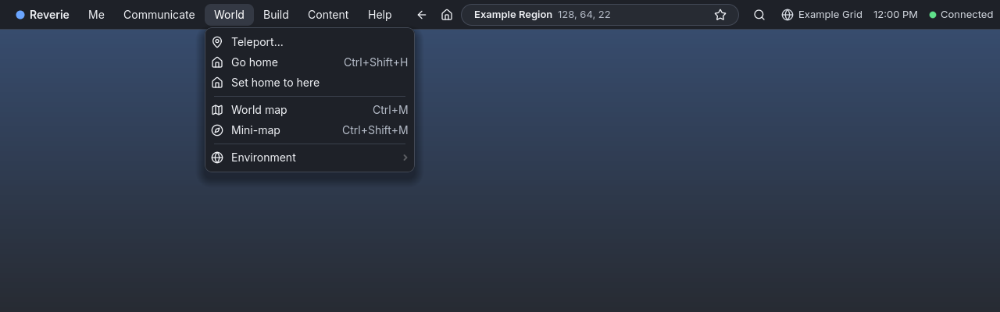
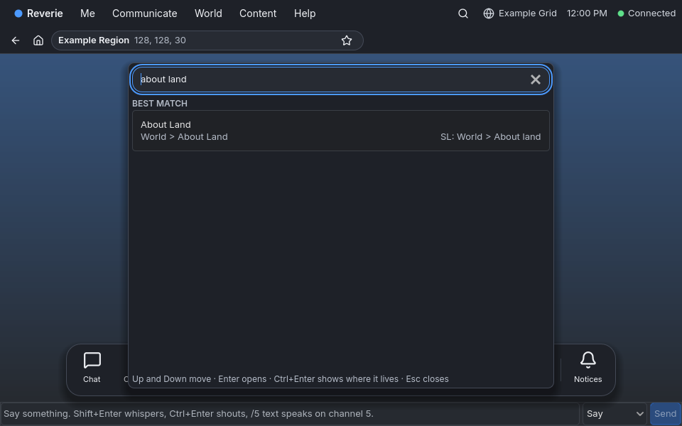

# Finding your way around

This section shows the parts of the Reverie window you use all the time: the top bar, the dock, the command search, and the windows that open on top of the world.

## The top bar

The top bar runs across the top of the window. From left to right it has:

- **The Reverie menu.** It holds About, Preferences, Add-ons, Check for updates, Log out and Quit. When the grid tells the viewer its name, the name shows here in place of "Reverie".
- **Six menus:** **Me**, **Communicate**, **World**, **Build**, **Content** and **Help**.
- **Back and Home.** **Back** takes you to the place you teleported from. **Home** takes you home.
- **The location box.** It shows the parcel, the region and where you stand. To go somewhere, click it, type a region name or an address, and press Enter. An address on another grid works too (Hypergrid): `hop://host:port/Region/x/y/z`, `host:port:Region`, `host:port Region` or `http://host:port/ Region`. While you visit another grid the box shows the region with that grid's host, and the top bar says **Visiting** with the grid's name and host. Back takes you to where you were, on whichever grid that was.
- **The landmark star.** It makes a landmark of where you stand, in your Landmarks folder. A landmark made on another grid remembers that grid: double-click it in the inventory to see where it leads, and press **Teleport** to go back there.
- **Going home from another grid.** **Go home** tries the teleport home first. If your home grid refuses it, a dialog says so and offers **Log out and back in at home**; Cancel keeps you where you are.
- **Links to other grids.** A hop:// link in chat, a message, a notecard, a group notice or a parcel's description asks before it takes you anywhere, and shows the region and its grid.
- **The status area.** The search button, the grid you are on, the time, your balance on grids that have one, and the connection state.

### What is in the menus

| Menu | What you find |
|---|---|
| **Me** | Appearance, Gestures…, Add-ons, Preferences…, Quit |
| **Communicate** | Nearby chat, Conversations, People, Notifications |
| **World** | Teleport…, Go home, Set home to here, About Land, World map, Mini-map, Environment |
| **Build** | Build, its tools, Link and Unlink, Options, Scripts, Upload |
| **Content** | Inventory, Outfits |
| **Help** | About this viewer |

A menu entry that has a shortcut shows it on the right. The [cheat sheet](../FEATURES.md) lists all the shortcuts.

### Open a window from a menu

1. Click the menu's name on the top bar, for example **Communicate**.
2. Click the entry you want, for example **Nearby chat**.

The window opens. Choosing it again closes it.

## The dock

The dock is the row of buttons at the bottom of the window. It is for the windows you use most. The buttons are in groups:

| Group | Buttons |
|---|---|
| Talk | Chat, Convos, People |
| World | Teleport, Map, Mini-map |
| Me | Inventory, Outfits, Appearance |
| Make | Build |
| Alerts | Notices |

Click a button to open its window. If the window is already open but behind another one, the click brings it to the front. Click the button of a window that is in front to close it.

A button shows as on while its window is open.

### Buttons that add-ons put on the dock

An add-on can put its own buttons in the **Make** group, after **Build**. The animation overrider puts an **AO** button there. Some buttons have a small arrow on them. The arrow, or a right-click on the button, opens that button's menu. For the **AO** button, the menu lists your animation sets and **Edit sets...**. A click on the **AO** button itself turns the overrider on or off. See the cheat sheet's line on the [animation overrider](../FEATURES.md#inventory-and-appearance).

## The command search

The command search finds a window, a command or a setting by its name. Use it when you know what you want but not which menu it is in.

1. Press **Ctrl+Shift+K**. Or click the search button in the top bar.
2. Type a name. You can use a name from this viewer, from Second Life, or from Firestorm.
3. The results come in groups: Best match, Windows, Commands and Settings. Each result shows where it lives in Reverie, its shortcut, and where Second Life keeps it (or Firestorm, when Second Life has no place for it).
4. Press **Up** and **Down** to move between results.
5. Press **Enter** to open the result.

Other keys:

- **Ctrl+Enter** opens the menu or the Preferences page the result lives in, and marks it, so you learn where it is.
- **Esc** closes the search.

With nothing typed, the search shows the things you picked recently.

If you type the name of something Reverie does not have yet, the search says so and tells you where Second Life or Firestorm keeps it. The list of those things is at the end of the cheat sheet, under "Not in Reverie yet".

The search does not open on the login screen. It works once you are logged in.

## Windows

Most of Reverie's tools open as windows on top of the world: Inventory, People, Preferences and so on.

Every window has a title bar with two buttons at its right end: **Minimize** and **Close**.

- **Move a window.** Press on its title bar, hold the button, drag, and let go.
- **Resize a window.** Drag one of its edges or corners. The corner at the bottom right has a small grip. Some windows cannot be resized.
- **Minimize a window.** Press **Minimize**. The window folds up to its title bar, and the button changes to **Restore**. Press it, or click the title bar, to open the window again.
- **Close a window.** Press **Close**, or choose its menu entry again. **Ctrl+W** closes the window in front.
- **Bring a window to the front.** Click it, or click its dock button.

Reverie remembers where each window was and how big it was. The windows come back to the same place the next time you open them, even after you restart.

Windows do not dock to each other or to the edges of the screen. The dock at the bottom is a row of buttons, not a place where windows sit.

## Changing how it looks

Preferences has an **Interface** page for the theme, the accent colour, the window opacity and the interface size. See the [cheat sheet](../FEATURES.md#settings-and-add-ons).

## Next

The [feature cheat sheet](../FEATURES.md) says what you can do in each area, and where to find it.
