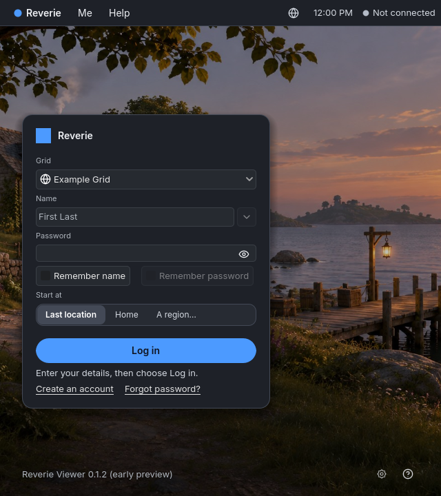

# Installing and first login

This section takes you from the download to standing in a world. It covers Windows and Linux, adding a grid, and logging in.

## What you need

- A graphics card and driver with Vulkan 1.3, or Direct3D 12 on Windows. If yours is too old, the viewer says so and does not start.
- 8 GB of memory (16 GB is better) and 2 GB of video memory (4 GB is better).
- An account on a grid. Your grid's website shows how to make one.

The full list is in [SPECS.md](../SPECS.md).

## Install on Windows

1. Download the Windows zip from the release page.
2. Unpack the whole zip into a folder of its own. Keep the files together.
3. Double-click `Reverie.exe`.
4. The release is not code-signed yet, so Windows may show **Windows protected your PC**. Choose **More info**, then **Run anyway**. Windows asks this once for each new version.

To watch the viewer's log while it runs, start `Reverie.console.exe` instead.

## Install on Linux

1. Download the Linux file for your computer: x86_64, or ARM64.
2. Unpack it: `tar -xzf` followed by the file name.
3. Run the `reverie` file in the unpacked folder.

`reverie` checks that a window can open and tells you what is missing if not. You need a graphics driver with Vulkan 1.3.
The [README](../../README.md) lists the packages a minimal system needs. The Linux builds have not yet been tried on a real
Linux desktop by the developers, so please report what happens.

## Add your grid

Second Life is already in the grid list. To use an OpenSimulator grid, add it once:

1. On the login screen, open the **Grid** list.
2. Choose **Add a grid…**.
3. Type the grid's login address. Your grid's website gives it. It looks like `https://grid.example.org:8002/`.
4. Choose **Look up**. The viewer asks the grid for its name, its sign-up and password pages, and whether it has hypergrid and a currency. It shows what it found.
5. If the address starts with `http://`, the window warns that the connection is not encrypted. Use the `https://` address if your grid has one.
6. Change the name shown if you like.
7. Choose **Add grid**.

The grid is now in the list, and the viewer remembers it.

To change or remove a grid later, open the **Grid** list and choose **Manage grids…**. You can refresh a grid's information, edit it or remove it there.

## Log in

1. In the **Grid** list, choose your grid.
2. Type your **Name**. This is your first and last name, such as `Test User`. Some grids use a single name.
3. Type your **Password**. Choose the eye to see what you typed.
4. Under **Start at**, choose **Last location**, **Home**, or **A region…** and type the region's name.
5. Choose **Log in**.

The line under the button shows how the login is going. If it fails, it says why.

### Remembering your details

- Tick **Remember name** to have the viewer remember the names you use on each grid. Open the list beside the Name box to pick one, or to forget one.
- Tick **Remember password** to keep your password too. It is stored protected for your Windows or Linux user account, never as plain text. If this computer has no protected place for it, the box is greyed and says so.

### If the connection drops

A window called **Logged out** tells you why. Choose **Reconnect** to log in again. The viewer does not reconnect until you choose it. See [Fixing problems](fixing-problems.md#the-connection-drops).

## Where the viewer keeps its files

| | Windows | Linux |
|---|---|---|
| Settings | `%APPDATA%\ReverieViewer` | `~/.config/ReverieViewer` |
| Cache | `%LOCALAPPDATA%\ReverieViewer\Cache` | `~/.cache/ReverieViewer` |
| Logs | `%LOCALAPPDATA%\ReverieViewer\Logs` | `~/.local/state/ReverieViewer/logs` |

The viewer writes nothing into the folder it runs from.

## Next

See what you can do once you are in: the [feature cheat sheet](../FEATURES.md).
