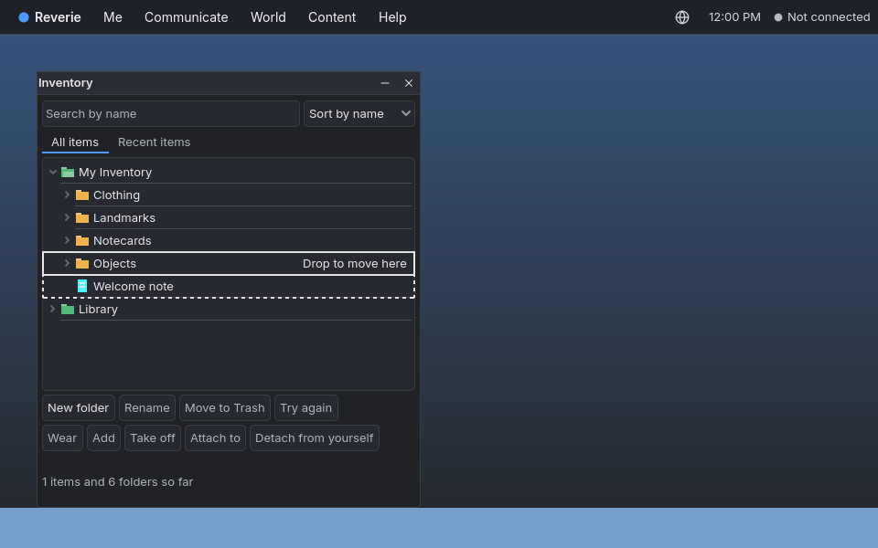
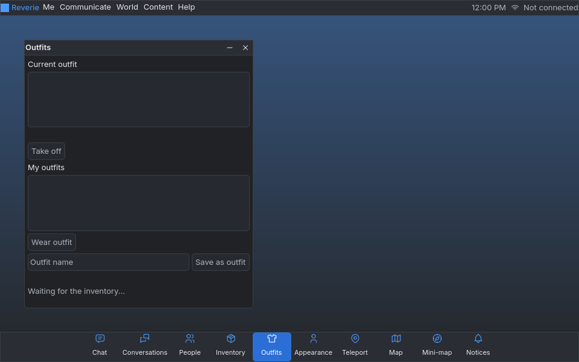
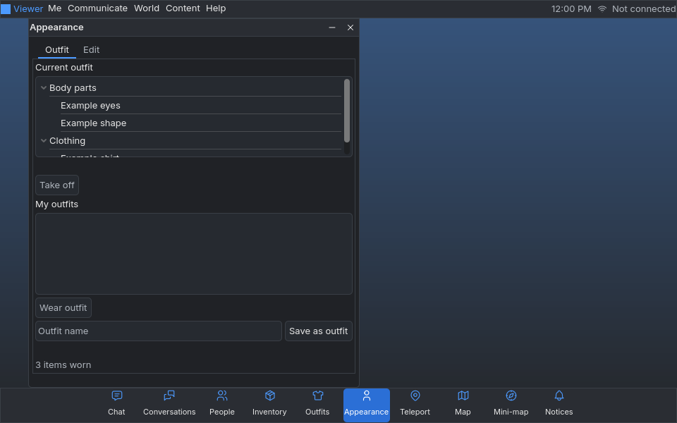
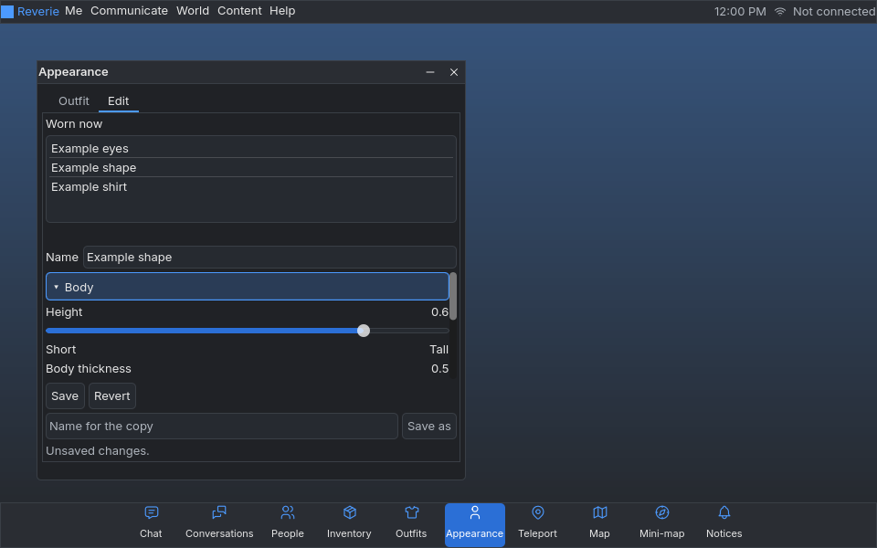
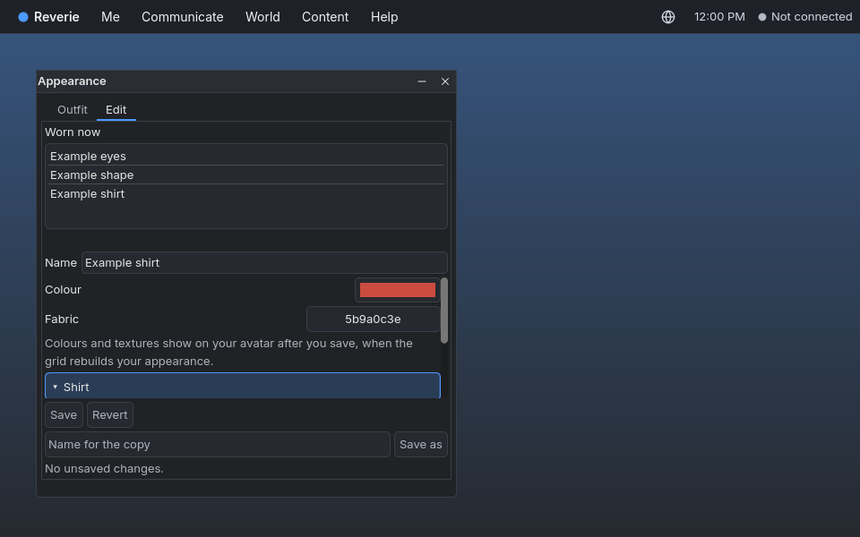
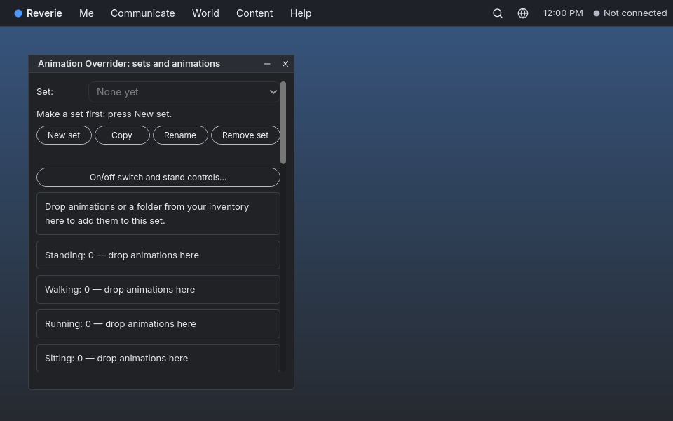

# Inventory, outfits and appearance

This section covers your inventory, what you wear, how you look, and the animation overrider.

All of it needs a login. The windows open from the **Content** and **Me** menus, from the dock, or by their key. See [Finding your way around](finding-your-way-around.md).

## Keys at a glance

| Keys | What |
|---|---|
| Ctrl+I | Inventory window |
| Ctrl+O | Outfits window |
| Ctrl+Shift+K | Search for a window or command by name (for example "appearance") |
| Enter (on a row) | Open a folder or an item |
| Left, Right (on a folder) | Close it, open it |
| Up, Down | Move the selection |

The Appearance window and the animation overrider have no key. Open them from the **Me** menu or the dock.

## The Inventory window

Open it with **Content > Inventory** (Ctrl+I), or the **Inventory** button on the dock.

The window shows a tree. **My Inventory** is yours. **Library** holds items that come with the grid. You cannot change the Library.

A folder is read from the grid when you open it. The line at the bottom says how many items and folders have loaded so far. If a folder fails to load, a **Try again** button appears.

### Browse

1. Click the arrow next to a folder to open or close it. You can also select it and press Right or Left.
2. Double-click a name, or press Enter, to open or close a folder.
3. Double-click an item, or press Enter on it, to open it. A notecard, a script, a gesture and a texture open in a window of their own (a gesture in the gesture editor). Other kinds do not open from here.

An item you are wearing shows **(worn)** after its name.

### Tabs and order

- **All items** shows the whole tree.
- **Recent items** shows items that arrived since you last logged out.
- The box next to the search line sorts by **name** or by **date**. The viewer remembers your choice.

### Search

Type in the **Search by name** line. The tree shows only the matches. Folders that have not loaded yet are still being read, and the status line says so. Clear the line to see the tree again.

### Select more than one row

- Ctrl+click adds a row, or takes it out again.
- Shift+click adds every row from the selected one to the one you click.

### Folders

1. Select the folder you want the new one inside. If nothing is selected, it goes into My Inventory.
2. Press **New folder**.
3. Type a name and press Enter.

### Rename

1. Select a folder or item.
2. Press **Rename**, or right-click it and choose **Rename**.
3. Type the new name and press Enter.

A name needs 1 to 63 characters. System folders (Clothing, Notecards and the like) cannot be renamed, moved or removed. You cannot rename an item you may not modify.

### Move

Drag a row onto a folder. While you drag, the folder under the pointer gets an outline and the words "Drop to move here". Drop on an item, and the item's own folder is used. If you selected several rows, they all move together.

A folder cannot go inside itself. A worn item cannot go to the Trash.

### Trash

1. Select a folder or item.
2. Press **Move to Trash**, or right-click it and choose it.
3. A bar under the tree asks "Move ... to the Trash?". Press **Move to Trash** to confirm, or **Cancel**.

Reverie cannot empty the Trash yet. Use another viewer for that.

### The right-click menu

Right-click a row to select it and open a menu. It has **New folder**, **Rename**, **Move to Trash**, **Wear**, **Add**, **Take off**, **Attach to**, **Detach from yourself**, **Open** and **Create new**. An entry is greyed when it does not apply to the row.

## Make new items

There are two ways.

- Press the **+** button under the tree. The new item goes into the folder for its kind (a new notecard goes into Notecards).
- Right-click a row and choose **Create new**. The new item goes into the folder you clicked, or the folder of the item you clicked.

The menu offers **New folder**, **New Script**, **New Notecard**, **New Gesture**, and two submenus:

- **New Clothes**: Shirt, Pants, Shoes, Socks, Jacket, Skirt, Gloves, Undershirt, Underpants, Alpha, Tattoo, Universal and Physics.
- **New Body Parts**: Shape, Skin, Hair and Eyes.

When the item appears, its name opens for typing. Type a name and press Enter, or press Esc to keep the default one.

What opens by itself:

- A new gesture opens in the gesture editor, and is switched on.
- A new shirt, shape or other body part or clothing opens in the Appearance window's **Edit** tab. The exceptions are **Alpha**, **Tattoo** and **Universal**: Reverie has no editor for those yet, and says so in the status line.
- A new notecard or script does not open. Double-click it when you want to write in it.

The new notecard or script is empty. Notes on the editors are in [Building and scripting](building-and-scripting.md).

## Wear, add, take off, attach and detach

Select an item, then use the buttons under the tree. A button is greyed when it does not apply. Each of these is also in the right-click menu.

| Button | What it does |
|---|---|
| **Wear** | Puts the item on and replaces what it replaces (a new shirt replaces the shirt you wear). On an outfit folder, it wears that outfit. |
| **Add** | Puts the item on without replacing anything. For a clothing layer or an object. A body part is not offered: there is only one of each. |
| **Take off** | Takes a worn clothing item off. A body part cannot be taken off, only replaced. |
| **Attach to** | Opens a list of places on your avatar. Choose one to attach an object there. The top choice, **Where it was last worn**, uses the place the object had before. The list includes HUD places. |
| **Detach from yourself** | Takes a worn object off. |

The grid rebuilds your look after a change. The Outfits window says "Your look was updated" when it is done.

If you wear as many attachments as the grid allows, wearing another one is refused. Take one off first.

You can also work from the world:

- Right-click an object you own in the world and choose **Attach** or **Attach HUD**, then a place.
- Right-click your own avatar. The menu has **Take Off** (with a **Clothes** list and your worn items) and **Detach**.

If a restraint (RLV) locks an object, it cannot be taken off, and its entry is greyed. RLV is off until you turn it on in **Me > Add-ons**.

## Outfits

Open **Content > Outfits** (Ctrl+O), or the **Outfits** button on the dock. The **Outfit** tab of the Appearance window shows the same panel.

**Current outfit** lists what you wear now, in groups: Attachments, Body parts, Clothing and Other. If your look came from a saved outfit, a line says "From outfit: ...".

**My outfits** lists the outfits you saved. They are folders under the My Outfits folder of your inventory.  With none saved, it says so.

### Take something off

1. Select it in **Current outfit**.
2. Press **Take off**.

### Wear a saved outfit

1. Select it in **My outfits**.
2. Press **Wear outfit**.

This replaces your current outfit.

### Save what you wear as an outfit

1. Type a name in the **Outfit name** line.
2. Press **Save as outfit**.

The status line says "Outfit saved." The name needs 1 to 63 characters.

## The Appearance window

Open **Me > Appearance**, or the **Appearance** button on the dock. You can also right-click your own avatar and choose **Appearance**.

The window has two tabs: **Outfit** (see above) and **Edit**.

### Edit something you wear

1. Open the **Edit** tab.
2. Choose an item in **Worn now**. It lists your body parts and clothing. Reverie reads its file from the grid. "Opening it..." shows while that happens.
3. Change what you want.
4. Press **Save**.

The status line shows "Unsaved changes." until you save. After a save it says "Saved. The grid is rebuilding your appearance." Your own avatar shows colour and texture changes after that rebuild. The sliders for the body show at once.

You can also rename the item in the **Name** line.

Other buttons:

- **Revert** puts the item back as it was at your last save.
- **Save as** makes a copy. Type a name in the line next to it, then press **Save as**.
- If you pick another item or close the window with unsaved changes, a question appears: **Save**, **Don't save** or **Cancel**.

If you may not modify the item, you can look at it but not change it. If you may not copy it, **Save as** is off.

### Shape, skin, hair and eyes

These body parts have sliders in folding groups. Click a group's heading to open it. Each slider names its two ends. For example:

- **Shape**: Body, Head, Eyes, Ears, Nose, Mouth, Chin, Torso and Legs.
- **Skin**: Skin colour, Face detail, Makeup and Body detail.
- **Hair**: Hair colour, Hair style, Eyebrows and Facial hair.
- **Eyes**: Eyes.

If the sliders are missing, the window says the avatar definition is not installed. Colours and textures still work.

### Clothing

Shirt, pants, shoes, socks, jacket, gloves, undershirt, underpants and skirt have a colour, one or two texture slots, and sliders. A **Physics** item has sliders for bounce and sway.

**Change a colour**

1. Click the colour box.
2. Pick a colour in the colour picker. See [Building and scripting](building-and-scripting.md#the-colour-picker).

**Change a texture**

1. Press the button of the slot. It reads **Change** when a texture is set, or **Not set**.
2. A list of the textures in your inventory opens. Type in the search line to narrow it.
3. Choose one, then press **Choose a texture**. Double-clicking a row does the same.

The list also has:

- **Default**, which puts the slot back to its default texture.
- **None**, for a slot that may be empty.
- **Cancel**.

Every texture in an item must be one you may modify, copy and transfer. If not, the save fails, and the status line says so.

### Texture slots start at the defaults

A new item starts with every slot at the default texture for its kind, as in Second Life:

- Eyes and hair have their own default pictures.
- Clothing and alpha slots start with the plain white texture.
- Skin, tattoo and universal slots start with the default avatar texture.

**Default** in the texture list gives a slot that texture again.

## The animation overrider (AO)

The animation overrider replaces your avatar's own animations (stand, walk, sit and so on) with ones from a set you choose. It is built in and on by default. You can turn the whole add-on off in **Me > Add-ons**.

### Where the sets come from

Reverie reads the sets from the **#AO** folder inside the **#Firestorm** folder of your inventory. This is the place Firestorm uses, so sets made there work here.

- Each folder inside **#AO** is one set.
- Each set holds folders named after a state, such as Standing, Walking, Running, Sitting and Flying. The animations go in those folders.

If no sets are found, the AO window says so.

### Switch it on and off

- Click the **AO** button on the dock. A click turns it on or off.
- Open the button's arrow, or right-click it, to see your sets. Choose one to use it. The set in use has a tick.

### Use it

1. Open **Me > Animation Overrider**. This is the sets editor.
2. Press **On/off switch and stand controls...** to open the small **Animation Overrider** window.
3. In the small window, tick **Use my animation set**.
4. Choose a set in **Set:**.
5. Press **Previous** or **Next** to change the animation of what your avatar is doing now, such as the stand.
6. If you changed the folders in your inventory, press **Read my sets again**.

### Edit sets

In the sets editor:

- **New set**, **Copy**, **Rename** and **Remove set** work on sets. New set, Copy and Rename ask for a name. Type it and press Enter. Esc cancels. A name cannot contain a colon, and no two sets may share a name.
- Remove set moves the set to the Trash, after a question.
- **Animations of:** shows the animations of one state. Press the ▶ button beside a name to try it. **Remove** moves it to the Trash.
- Drop animations or a whole folder from your inventory onto the drop area to add them. A list shows where each animation will go. Check it, then press **Add**. Nothing changes before that.

## Not in Reverie yet

- Emptying the Trash, copy and paste in the inventory, item properties and a Worn tab (the cheat sheet lists more).
- An editor for Alpha, Tattoo and Universal items.

See also [Keyboard shortcuts](keyboard-shortcuts.md) and [Fixing problems](fixing-problems.md).
