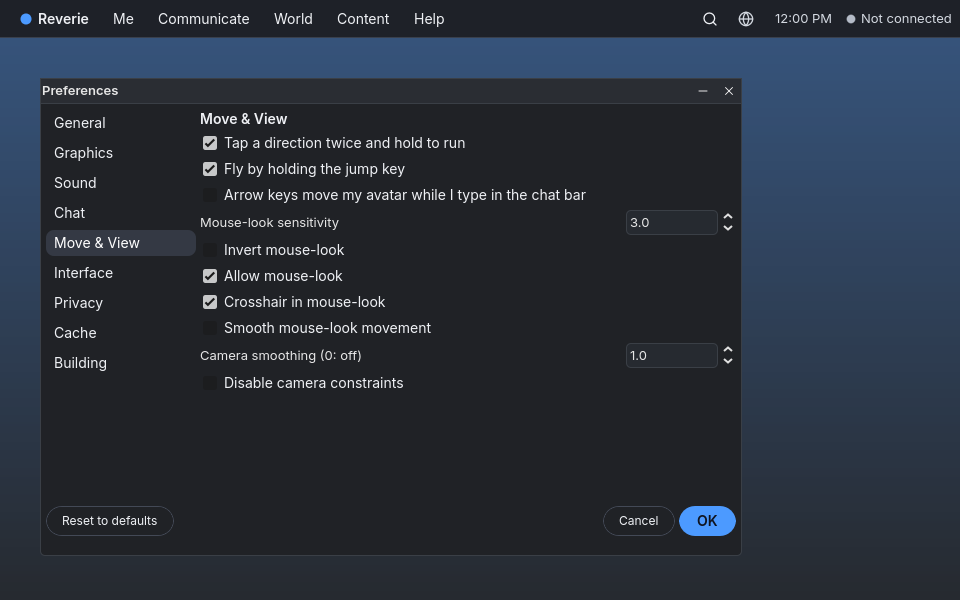

# Moving and the camera

This section shows how to move your avatar and how to look around: walking, running, flying, sitting, mouselook and the camera.

You need to be logged in. Keys move your avatar only while the world has the keyboard. If you are typing in a text box, click the world first. (The one exception is in the [Move & View preferences](#the-move--view-preferences).)

## The keys at a glance

| Keys | What they do |
|---|---|
| W or Up | Walk forward |
| S or Down | Walk back |
| A or Left | Turn left |
| D or Right | Turn right |
| Shift+A or Shift+D (Shift+Left, Shift+Right) | Slide left or right |
| E or Page Up | Jump (when flying: go up) |
| C or Page Down | Crouch (when flying: go down) |
| F or Home | Fly or land |
| Shift, held while flying | Fly faster |
| Space | Stop moving |
| Ctrl+R | Always run on or off |
| M | Mouselook on or off |
| Esc | Reset the view (in mouselook: leave it) |
| Alt+drag | Orbit and zoom the camera |
| Ctrl+Alt+drag | Orbit the camera |
| Ctrl+Alt+Shift+drag | Pan the camera |
| Alt+click | Focus the camera on what you click |
| Scroll wheel | Zoom the camera |

## Walking, turning and sliding

1. Click the world once, so the keyboard is yours.
2. Hold **W** to walk forward, or **S** to walk back.
3. Hold **A** to turn left, or **D** to turn right.
4. To slide sideways without turning, hold **Shift** and press **A** or **D**.
5. Press **Space** to stop.

The arrow keys do the same as W, A, S and D.

You can also steer with the mouse. Press the left button on the world and drag. Your avatar turns to face the spot you grabbed. A short click is still just a click.

## Running

There are two ways to run.

- **Always run.** Press **Ctrl+R**. Your avatar runs whenever it walks. Press **Ctrl+R** again to go back to walking.
- **Tap and hold.** Tap a walk key twice. Keep the second press down. Your avatar runs until you let go.

Tap-and-hold running can be turned off in Preferences > Move & View.

## Jumping and crouching

1. Tap **E** (or **Page Up**) to jump.
2. Hold **C** (or **Page Down**) to crouch.

## Flying

1. Press **F** or **Home**. Your avatar starts to fly. Press it again to land.
2. While you fly, hold **E** to go up and **C** to go down.
3. Walk keys move you forward, back and around, as on the ground.

Two more ways to start flying:

- Hold the jump key (**E**) for about half a second. This is called automatic fly. You can turn it off in Preferences > Move & View.
- Right-click your own avatar and choose **Fly**. The same menu shows **Stop Flying** while you fly.

While you fly, a **Stop Flying** button also shows at the bottom of the window. Press it to land.

### Flying faster

1. While you fly, hold **Shift** and move with the usual keys.
2. Let go of **Shift** to fly at the normal speed again.

Shift with **A**, **D**, **Left** or **Right** slides sideways, in flight too. If you are already turning, press Shift after the turn key and you keep turning.

The region decides how fast you go. On an OpenSim region that uses the ubODE physics engine you fly about 1.6 times as fast over the ground. Going up and down is no faster. Some regions have no faster flying: there Shift does not change your speed forward or back. If Always run is on, you already fly at the faster speed. Shift does not speed up flying on Second Life.

## Sitting and standing

To sit on an object:

1. Right-click the object.
2. Choose **Sit Here**.

To sit on the ground:

1. Right-click the ground, close to your avatar. It must be within about 3 metres.
2. Choose **Sit Here**.

To stand up, do one of these:

- Press the **Stand** button that shows at the bottom of the window while you sit.
- Right-click your avatar and choose **Stand Up**.
- Right-click the object you sit on and choose **Stand Up**.

While you sit, the W, A, S, D and arrow keys move the camera, not the avatar. Some seats and scripts take the keys for themselves. Then the keys go to the seat or script instead.

## Mouselook

Mouselook puts the camera at your avatar's eyes. The mouse then turns your view, with no pointer on the screen.

1. Press **M**. Or scroll the wheel forward until you are past the closest zoom.
2. Move the mouse to look around.
3. To leave, press **Esc**, or press **M** again, or scroll the wheel back.

In mouselook, A and D (and Left and Right) slide you sideways. They do not turn you. The mouse turns you.

A script can also ask for mouselook. A seat can force it too.

If you do not want mouselook, turn off **Allow mouse-look** in Preferences > Move & View.

## The camera

The camera follows your avatar from behind. You can move it around.

### Orbit

Hold **Alt** and press the left button on the world. Then drag.

- Drag left or right to go around.
- Drag up or down to zoom. Pulling the mouse up zooms in.

To orbit up and down too, hold **Ctrl+Alt** and drag.

The keys do the same. Hold **Alt** and press:

| Keys | What the camera does |
|---|---|
| Alt+Left or Alt+A | Goes around one way |
| Alt+Right or Alt+D | Goes around the other way |
| Alt+Up or Alt+W | Moves in |
| Alt+Down or Alt+S | Moves out |
| Alt+Page Up or Alt+E | Tilts up and over |
| Alt+Page Down or Alt+C | Tilts down and under |

### Zoom

Scroll the wheel. Scroll forward to zoom in, and back to zoom out. If you zoom in past the closest point, you go into mouselook.

### Pan

Hold **Ctrl+Alt+Shift**, press the left button, and drag. The camera slides sideways and up and down without turning.

The keys: hold **Ctrl+Alt+Shift** and press the arrow keys or W, A, S and D.

### Focus

Hold **Alt** and click an object, an avatar or the ground. The camera now looks at that spot. If you keep the button down and drag, the camera orbits around it. A click on the sky does nothing.

### Reset

Press **Esc**. The camera goes back behind your avatar. Your avatar does not turn.

## The Move & View preferences

Open them with **Preferences** (Ctrl+P), then choose **Move & View**.

| Setting | What it does |
|---|---|
| Tap a direction twice and hold to run | Turns tap-and-hold running on or off. On by default. |
| Fly by holding the jump key | Turns automatic fly on or off. On by default. |
| Arrow keys move my avatar while I type in the chat bar | Lets the arrow keys walk you while a text box has the keyboard. Off by default. |
| Mouse-look sensitivity | How far the view turns for each movement of the mouse. From 0 to 15. The default is 3. |
| Invert mouse-look | Moving the mouse up looks down. Off by default. |
| Allow mouse-look | Turns mouselook on or off. On by default. |
| Crosshair in mouse-look | Shows a small cross in the middle of the view in mouselook. On by default. |
| Smooth mouse-look movement | Eases the mouse movement. Off by default. |
| Camera smoothing (0: off) | How softly the camera follows you. From 0 to 4. The default is 1. |
| Disable camera constraints | Lets the camera go further than usual: past the draw distance, and without a closest zoom. Off by default. |

Every change takes effect at once. Press **OK** to keep your changes, or **Cancel** to put them back.

## Not in Reverie yet

- A camera controls window, and saved camera views.
- A key binding editor. Reverie uses the standard keys in the table above.
- Pressing **Enter** does not jump to the chat bar yet. Click the chat bar to type. See [Chat and people](chat-and-people.md).

## Next

[Chat and people](chat-and-people.md) shows how to talk to people nearby and in private.

## Camera views

Open **Avatar > Camera controls...** (Ctrl+K). **Front view**, **Side view** and **Rear view** move the camera there. To keep a view of your own, turn and zoom the camera, type a name and press **Save as preset**. Pick it again under **Use preset**; **Delete** removes it. Your presets and the picked view stay after a restart.
