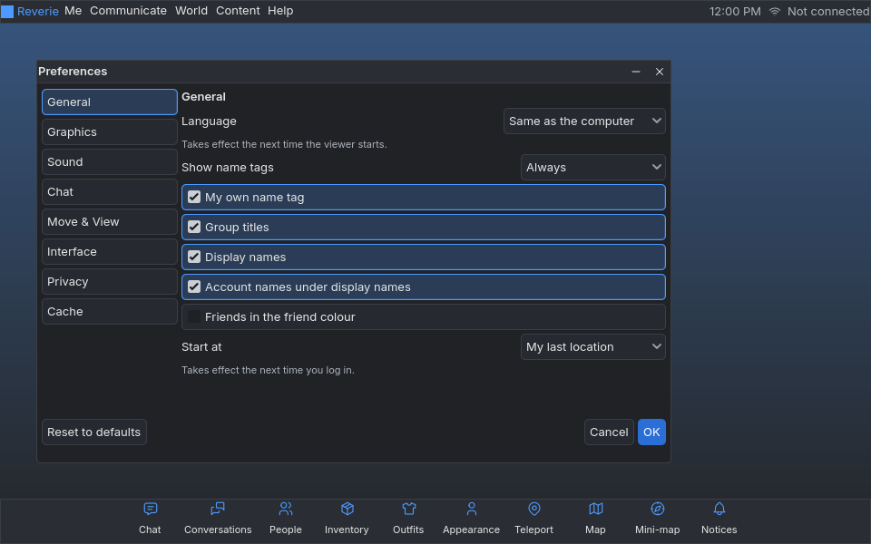
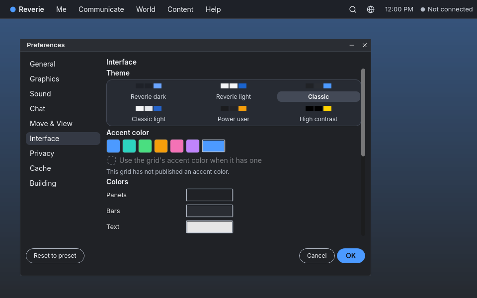

# Preferences and add-ons

This section covers the **Preferences** window, with a line or two on each page, then themes and interface size, and the **Add-ons** window.

## Open Preferences

Choose **Me > Preferences…** (Ctrl+P). Or choose **Preferences...** in the Reverie menu.

The window has a list of pages on the left: **General**, **Graphics**, **Sound**, **Chat**, **Move & View**, **Interface**, **Privacy**, **Cache** and **Building**. Click a page to see it.

At the bottom there are three buttons:

- **OK** keeps the changes on every page and closes the window.
- **Cancel** puts back what was saved and closes the window. Closing the window with its close button does the same.
- **Reset to defaults** puts the page you are looking at back to its defaults. On the Interface page it is called **Reset to preset**.

Most changes show at once, so you can see what they do before you press **OK**.

Some settings carry a note under them:

- "Takes effect the next time the viewer starts." Close and start the viewer again.
- "Takes effect the next time you log in."
- "Kept separately for each account. Log in to change it."

### Find a setting by name

You do not need to know the page. Press **Ctrl+Shift+K**, type the setting's name, and choose it. Preferences opens on the right page, with that row marked. See [Finding your way around](finding-your-way-around.md).

## The pages

### General

- **Language.** The viewer's language. English is the only one so far. "Same as the computer" is the default. Needs a restart.
- **Show name tags.** **Never**, **Always** or **Briefly**.
- Choices for what a name tag shows: your own, group titles, display names, account names under display names, and friends in the friend colour.
- **Start at.** Where you arrive when you log in: **My last location** or **My home**.

### Graphics

- **Quality.** A preset from **Low** up to **Ultra**. It sets the draw distance and the largest texture together. If you set those to a pair that no level has, the preset reads **Custom**.
- **Draw distance (metres).** How far you see. From 64 to 1024.
- **Largest texture (pixels across).** From 256 to 2048.
- **Frame-rate limit.** 0 means no limit. Up to 360.
- **Vertical sync**, **Clouds** and **Show neighbouring regions**. The last one applies at your next login.
- **Keep my sky choice for the next login** and **Use the region's sky again after a teleport**. The first starts on and the second off (see the sky section of the world guide).
- **Rendering backend.** **Automatic**, **Vulkan** or **Direct3D 12**. Needs a restart. If a backend will not start, choose **Automatic** and start the viewer again (see [Fixing problems](fixing-problems.md#switch-the-graphics-backend)).
- **Window at startup.** How the viewer opens: **Maximized window** (the default), **Last size and position**, or **Full screen**. A change to or from **Full screen** applies at once. In a window you have the system title bar and a taskbar button and can minimize at any time. To switch between full screen and a window while the viewer runs, use **Me > Full screen** or Ctrl+Alt+F; **Me > Minimize** sends the window to the taskbar. If the screen the window was last on is gone, it opens maximized on your main screen.

Shadows, anti-aliasing and other advanced graphics settings are not in Reverie yet.

### Sound

- **Volume.** One row each for **Master**, **Sounds** (objects in the world), **Ambient** (footsteps), **Music** (the stream of the parcel you are on) and **Interface sounds**: a slider, its value and a **Mute** button. Muting Master is the same as **Mute all sounds**.
- **Options.** Whether collisions and gestures make sounds, **Mono audio** (both ears get the same sound) and muting while the viewer is minimized. A footstep the grid has no sound for is silent.
- **More** (closed at first) holds the balance-change amounts above which the money sound and the pain sound play.
- **Interface sounds** (closed at first; its summary says how many of the sounds are on). Open it and each event has a row: for example Alert, Click, Region restart and Teleport. Each row has a **Play** button and a choice of **Grid's** or **Off**. **Set all to Grid's** changes every row back. Reverie plays each grid's own interface sounds: it fetches them from the grid you are connected to when you log in, by the same sound ids the official viewer uses, and keeps them for that grid only, so one grid's sounds never play on another. A sound the grid does not have is silent (the row says "not on this grid"). On the login screen, the sounds of the grid chosen there play if you have connected to it before; otherwise nothing plays.

Media and voice are not in Reverie yet. Parcel music is: see **Parcel music** below.

#### Parcel music

A parcel can name a music stream (an internet radio address). When you stand on such a parcel, Reverie plays it.

- **The music control.** A music button appears in the top bar, left of the search icon, only while your parcel has music. One click turns the stream off, another turns it on; the button is dimmed while the music is off. Beside it are a **mute** button (the speaker icon, crossed out while muted) and a **volume** slider. They set the same **Music** level and mute as Preferences > Sound, so the two always agree.
- **Off stays off.** Music you turn off stays off on every parcel and after you log in again, until you turn it on.
- **The first time for a site.** When a parcel's stream would play from a site Reverie has not asked about, it asks once: **Play** or **Don't play**. It remembers your answer for that site. If you chose **Don't play** and change your mind, click the music button; Reverie asks again.
- **Changes.** If the parcel's owner changes the address, the music switches at once. An empty address, or leaving the parcel, stops the music.
- **What it plays.** Addresses that start with http:// or https://: MP3, AAC and Ogg Vorbis streams, a station's own address (also a bare server address such as http://example.org:8040), addresses that redirect, and .pls and .m3u playlists that name a stream. Other kinds of stream (for example HLS, or video) do not play.

### Chat

- **Chat text size (pixels).** From 10 to 32.
- **Seconds nearby chat stays over the view.** 0 keeps lines until newer ones push them out.
- **Show the time on chat and instant messages.**
- **Tell me when a friend comes online or goes offline.** On by default. It shows a notice for a few seconds; press the notice to open a conversation with that friend.
- **Also show that in nearby chat.** On by default. It adds a line such as "Ann Example is online." to nearby chat. The name in the line is a link: click it for the name menu.

### Move & View

- **Tap a direction twice and hold to run.**
- **Fly by holding the jump key.**
- **Arrow keys move my avatar while I type in the chat bar.**
- **Mouse-look.** Allow it, its sensitivity, invert it, a crosshair, and smooth movement.
- **Camera smoothing** (0 is off) and **Disable camera constraints**.

See [Moving and the camera](moving-and-the-camera.md).

### Privacy

- **Remember my username.**
- **Show my online status to friends.** Kept for each account.
- **Clear saved login names…** asks first, then forgets the names saved for the login screen.

### Cache

- **Cache folder.** Empty means the default folder. **Choose...** opens a folder picker. Needs a restart.
- **Cache size limit (MB).** From 256 to 65536. Needs a restart.
- **Clear cache…** asks first, then removes everything cached. It is fetched again when needed.

### Building

What the Create tool makes: the size, the material, the colour, transparency, glow, **Full Bright**, the texture (as its UUID), **Physical**, **Temporary**, **Phantom**, and what the next owner can do. See the cheat sheet for building.

### Interface

The look of the viewer. See the next part.

## Themes and interface size

Open **Me > Preferences…** and click **Interface**. Everything on this page restyles the whole viewer as you change it.

### Pick a theme

Under **Theme**, click one of: **Reverie dark**, **Reverie light**, **Classic**, **Classic light**, **Power user** or **High contrast**. A strip of colours over each name shows what it looks like.

The look you see before you pick anything is **Reverie dark**. Click **Reverie dark** or **Reverie light** to come back to it.

Picking a theme drops any colour changes you made on top of the old one. Your interface size stays.

### Change the colours

- **Accent colour.** Click one of the six swatches: blue, teal, green, amber, rose and violet. Or click the last box to choose any colour.
- **Use the grid's accent colour when it has one.** Some grids publish a colour. The box is grey when the grid you are on has not.
- **Colours.** **Panels**, **Bars**, **Text** and **Secondary text**. Click a box to change one.

### Window opacity

Two sliders, from 0 to 100 percent: **Active window** is the window you are using, **Other windows** are the rest.

### Interface size

1. Under **Interface size**, move the slider.
2. It runs from 75% to 400%, in steps of 5.

Until you move the slider, Reverie follows the scale of your display. Once you set a size, it is yours and stays.

### Readability

The page checks four pairs of colours: text on panels, secondary text on panels, the accent on bars, and button text. Each shows a ratio and either **Readable** or **Too low**.

If one is too low when you press **OK**, Reverie asks: "Some text will be hard to read with these colours. Save anyway?" Press **Save anyway**, or **Keep editing**.

### Share a theme

- **Export theme…** writes your look to a file.
- **Import theme…** reads a theme file. Press **OK** afterwards to keep it. A file that cannot be used is refused, and nothing changes.

Theme files end in `.json`. The theme is kept for each account.

## Add-ons

An add-on adds a feature to the viewer. Two come with Reverie: the animation overrider (AO) and RLV.

### Open the window

Choose **Me > Add-ons**. Or choose **Add-ons...** in the Reverie menu. Choose it again to close the window.

### What the window shows

At the top, a line for each **job** says which add-on does it. A job is a role that only one add-on may fill at a time. The two jobs are `ao` and `rlv`. Choose **None** to have no add-on do the job. Turning one add-on on turns off the other one for the same job.

Below that, every add-on found has:

- a tick box with its name. Tick it to turn the add-on on. Clear it to turn it off;
- a label, **comes with the viewer** or **installed by you**;
- its version, author, licence and job;
- a list called **It may:** with what it is allowed to do, such as read your inventory or play animations on your avatar;
- if it was switched off after an error, a note that says why. An add-on's error never takes the viewer down.

### The built-in add-ons

- **Animation Overrider.** It is on at first. The **AO** button on the dock turns it on and off, and its arrow lists your sets and **Edit sets...**. It reads your sets from the `#AO` folder inside the `#Firestorm` folder of your inventory. Clear its box in **Me > Add-ons** to turn the whole add-on off.
- **RLV.** It is off at first. Tick its box to turn it on. It takes effect the next time you log in, and the window says so: "Takes effect at next login." Clearing the box works the same way. While RLV is on, a menu entry **Me > RLV > Restrictions…** lists the objects that restrict you. Only part of the RLV commands work yet.

### Add-ons from outside

You can put in add-ons that other people made. They go in the `Addons` folder in the viewer's settings folder, one folder for each add-on. On Windows that is `%APPDATA%\ReverieViewer\Addons`. The viewer makes the folder when it starts, and looks for add-ons at start. So put a new one in place, then start the viewer.

An outside add-on is **off** until you turn it on. To turn one on:

1. Open **Me > Add-ons**.
2. Tick the add-on's box.
3. A window called **Turn on an add-on** appears. It lists what the add-on says it uses.
4. Press **Turn it on** to accept. Or cancel, and it stays off.

### What turning one on means

An add-on runs inside the viewer with full access to your computer, like any program you install. The list of permissions is what it says it needs. It is not a fence around it. So turn on only add-ons from people you trust.

An add-on that later asks for more permissions than you accepted stays off until you accept again. For how an add-on is built and what it can ask for, see [ADDONS.md](../ADDONS.md).

## Next

The [feature cheat sheet](../FEATURES.md) lists the rest of what Reverie can do.
