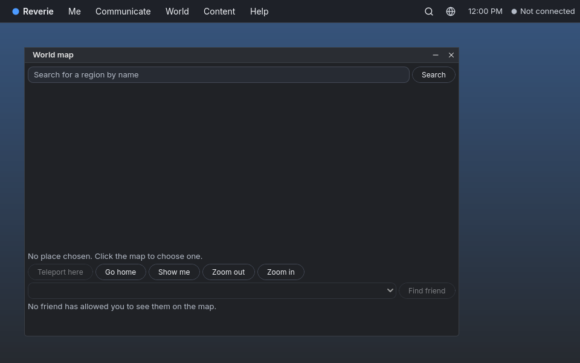
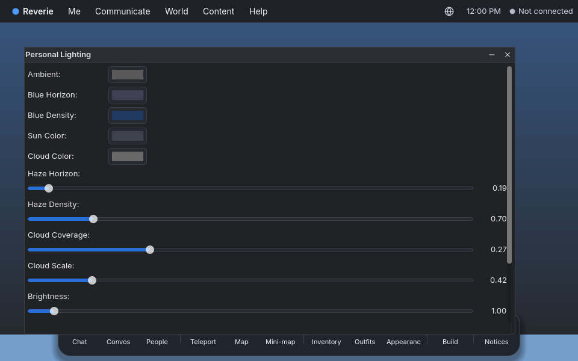

# The world

This section covers the maps, travel, the sky and the land: the world map, the mini-map, teleporting, going home, the environment, About Land, and what the viewer shows of the world around you.

All of this needs a login. The windows named here open from the **World** menu, from the dock, or by their key. See [Finding your way around](finding-your-way-around.md).

## Keys at a glance

| Keys | What |
|---|---|
| Ctrl+M | World map |
| Ctrl+Shift+M | Mini-map |
| Ctrl+Shift+H | Go home |
| Ctrl+Shift+S | Snapshot |
| Ctrl+Shift+O | Sunrise |
| Ctrl+Shift+Y | Midday |
| Ctrl+Shift+T | Midday (Legacy) |
| Ctrl+Shift+N | Sunset |
| Ctrl+Shift+Z | Midnight |
| F9 | Next sky in the cycle |

The sky keys work while you are in the world.

## The world map

The picture was taken before login, so no map shows in it. After login the map fills the empty area.

Open it with **World > World map** (Ctrl+M), or press **Map** on the dock.

### Look around the map

- **Move the map.** Press on it, hold the button, and drag.
- **Zoom.** Turn the mouse wheel. The map zooms at the pointer. Or press **Zoom in** and **Zoom out**.
- **Find yourself.** Press **Show me**. The map centres on where you are.

### Find a region by name

1. Click the box that says "Search for a region by name".
2. Type part of a region's name.
3. Press **Enter**, or press **Search**.
4. A list called "Regions found" appears. Click a region in it.

The map then marks that region. If there is no such region, or the grid does not answer, a line under the map says so.

### Pick a place

1. Click a spot on the map. A press that moves counts as a drag, not a click.
2. A cross marks the spot. The line under the map says "Chosen place" with the region's name and your position in it.
3. Press **Teleport here** to go there. The button is grey until you pick a spot.

### Find a friend

Under the buttons there is a list of friends and a **Find friend** button.

1. Choose a friend in the list.
2. Press **Find friend**. The map shows where they are.

The list holds only friends who have allowed you to see them on the map. If there are none, a line says so.

### Go home from the map

Press **Go home** to teleport to your home.

## The mini-map

Open it with **World > Mini-map** (Ctrl+Shift+M), or press **Mini-map** on the dock.

The mini-map shows the area around you.

- You are the dot in the middle.
- Other people are dots. A friend's dot has your accent colour. A dot drawn as a ring means the region does not say how high that person is.
- A pale wedge shows where your camera looks.
- The letters around the edge are the compass points. **N**, north, is in red.

To zoom, turn the mouse wheel over the map, or press **Zoom in** or **Zoom out**.

The box **Turn the map with the camera** is on at first. With it on, the map turns as you turn the camera. Clear it to keep north at the top.

A click on the mini-map does nothing. To travel, use the world map or the Teleport window.

## Teleporting

You can teleport four ways:

- **From the world map.** Pick a place and press **Teleport here**.
- **From the Teleport window.** See below.
- **From the location box** in the top bar. Click it, type a region name or an address, and press **Enter**.
- **To a friend.** Use **Offer Teleport** and **Request Teleport** on a person's right-click menu, or the Teleport window. See [Chat and people](chat-and-people.md).

### The Teleport window

Open it with **World > Teleport...**, or press **Teleport** on the dock.

1. Type the region's name in the **Region name** box.
2. Set **X**, **Y** and **Z**: how far east and north you land in the region, and how high, in metres. At first they are 128, 128 and 30.
3. Press **Teleport**. Or press **Enter** in the region box.

Further down, the same window lists teleport offers and requests that wait for your answer, and lets you offer a teleport to a friend or ask a friend for one. Nothing there is answered for you.

### While you teleport

A small panel appears over the world and says what is happening. A **Cancel** button shows while the grid still lets you cancel. Press it to stop.

If the teleport fails, the panel tells you why, and a **Close** button puts it away. Some common reasons:

- Teleports are limited to 6 a minute. Wait a minute and try again.
- The destination has entry rules you do not meet, or you have no access to it.
- The grid stopped answering.

A teleport inside your own region shows no panel.

## Going home, and setting home

- **Go home.** Choose **World > Go home** (Ctrl+Shift+H). Or press **Home** in the top bar, or **Go home** in the Teleport window or on the world map.
- **Set home.** Stand where you want your home to be. Choose **World > Set home to here**. Or press **Set home to here** in the Teleport window.

After you set your home, the region answers with a notice: "Your home is set to here." If it does not allow it, you see "You are not allowed to set your home on this parcel."

The **Back** button in the top bar takes you to the place you teleported from.

### Not in Reverie yet

Landmarks, a places list and a teleport history are not in this viewer yet. The landmark star in the top bar is greyed out.

## Snapshots

**World > Snapshot** (Ctrl+Shift+S) opens the Snapshot window and takes a picture. Press the same keys, or close the window, to leave it.

- **Refresh** takes the picture again. Changing the size or **Show interface** does too.
- **Size**: the window's own size, or a fixed size from 1920×1080 to 7680×4320. For a moment the view is drawn at that size; the viewer window keeps its own size. A size your graphics card cannot draw is refused with a message, and nothing is saved.
- **Format**: PNG, or JPEG with a quality from 1 to 100.
- **Show interface** is off, so the picture is of the world alone: no bars, windows, name tags, floating text or selection marks. When it is on, the Snapshot window itself is still left out. At a fixed size, the interface is drawn as it would be in a window of that size at 100 percent interface size, so it takes up less of a larger picture.
- **Save to disk** writes the picture as the next numbered file, such as Snapshot_001.png. A file is never written over. The first save asks for a folder (offered: Reverie in your Pictures folder) and remembers it; **Change...** picks another.

Saving to your inventory or profile, e-mail, filters and 360 pictures are not in this viewer yet.

## The environment

The environment is the sky, the sun and moon, the clouds, the haze and the water.

At first you see the region's own environment, as the grid sends it. A parcel can have its own environment too. The grid's day cycle moves with the grid's clock.

You can pick a different sky for yourself. Nobody else sees your choice.

### Pick a sky

1. Choose **World > Environment**.
2. Choose one of:
   - **Sunrise** (Ctrl+Shift+O)
   - **Midday** (Ctrl+Shift+Y)
   - **Midday (Legacy)** (Ctrl+Shift+T), the older style of midday sky
   - **Sunset** (Ctrl+Shift+N)
   - **Midnight** (Ctrl+Shift+Z)
3. A tick shows which one is in force.

To go back to what the region sends, choose **Use Shared Environment**.

Your choice stays when you teleport, and is kept for the next login until you choose **Use Shared Environment**; turn off **Keep my sky choice for the next login** under **Preferences > Graphics** to start each login on the region's sky. **Use the region's sky again after a teleport** (also under Graphics) puts the region's own sky back each time a teleport ends. That one starts off. If a sky cannot be loaded, the sky you had stays.

### The F9 cycle

F9 steps through the choices: **Use Shared Environment**, **Sunrise**, **Midday**, **Sunset**, **Midnight**, and back to **Use Shared Environment**. It skips **Midday (Legacy)**. If one of your active gestures uses F9, the gesture runs instead and the sky stays.

### Pause the clouds

Choose **World > Environment > Pause Clouds** to stop the clouds drifting. Choose it again to let them move.

### Personal Lighting

Personal Lighting lets you change the sky yourself.

1. Choose **World > Environment > Personal Lighting...**.
2. Click a colour box to change a colour: **Ambient**, **Blue Horizon**, **Blue Density**, **Sun Color** and **Cloud Color**.
3. Move a slider: **Haze Horizon**, **Haze Density**, **Cloud Coverage**, **Cloud Scale**, **Brightness**, **Glow Size** and **Glow Focus**. The window scrolls to reach all of them.
4. Every change shows at once, and only you see it.
5. Press **Reset** to put the region's environment back.

The official viewer's window also has cloud and water pictures, the sun and moon, and the star brightness. Those are not in Reverie yet.

## Under the water

Move the camera below the surface and the view changes, as it does in the official viewer. The water's colour closes in with distance, so far things fade into it. Look up and you see the sky and the land through the moving surface. Bring the camera back above the water and the view is as before. It works on every grid, and there is nothing to switch on.

See-through things under water, such as glass or soft-edged hair and plants, are fogged by the water as well. The air haze stays on what is above the water.

## About Land

About Land tells you about a parcel. It is for reading. You cannot change anything in it, and land and estate tools are not in Reverie yet.

To open it for the parcel you stand on:

1. Choose **World > About Land**.

To open it for a parcel you can see:

1. Right-click the ground there.
2. Choose **About Land**.

The window shows one line for each of these:

| Line | What it says |
|---|---|
| Name | The parcel's name. |
| Description | What its owner wrote. |
| Owner | Who owns it, or "Owned by a group". |
| Area (square metres) | How big it is. |
| Access list in use | Yes if only listed people may enter. |
| Ban list in use | Yes if some people are banned. |
| Group access only | Yes if it is open only to a group. |
| Payment information required | Yes if you must have payment information on file. |
| Age verification required | Yes if you must be age verified. |
| Passes are sold | Yes if you can buy a pass to enter. |

If passes are sold, two more lines show **Pass price** and **Pass lasts (hours)**.

While the region has not answered yet, the window says "Waiting for the region to answer."

## What the viewer draws

Reverie draws the world as the grid sends it. That includes:

- the region's and the parcel's sky and water settings;
- the ground, with its textures;
- prims, sculpted prims and meshes;
- glow, and projected lights;
- the regions next to yours.

Turn the neighbouring regions off in **Preferences > Graphics** (see [Preferences and add-ons](preferences-and-add-ons.md)).

### Other people

Other people are drawn the way the official viewer draws them.

- Someone who has just arrived appears once their look is complete: their shape, their skin and clothing layers, and what they wear. That takes a few seconds after they arrive.
- Parts of a person's body that their outfit hides are never drawn. An alpha layer, or a mesh body, hides the body under it.
- When someone changes clothes, you see their last finished look until the new one has arrived.
- When someone leaves, what they wear does not come off piece by piece in front of you: it goes with them.

### Parcels that keep you out

When a parcel does not let you in, you get a notice that says why: you are banned, you are not on its access list, or it is open only to a group.

The viewer also draws a wall at the edge of that parcel. It shows when you walk into the parcel's edge, and fades as you move away. A ban makes a very tall wall. An access list or a group makes a lower one.

There is no setting for the wall in Preferences yet.

### Region restarts

Regions restart now and then. Before one does, the grid sends a warning. The viewer shows it as a notice, with the grid's own words, and plays the "Region restart" sound. You can change that sound in **Preferences > Sound**.

## Next

The [feature cheat sheet](../FEATURES.md) lists what else you can do and where to find it.
